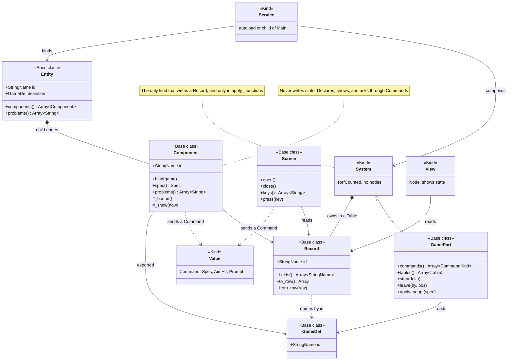
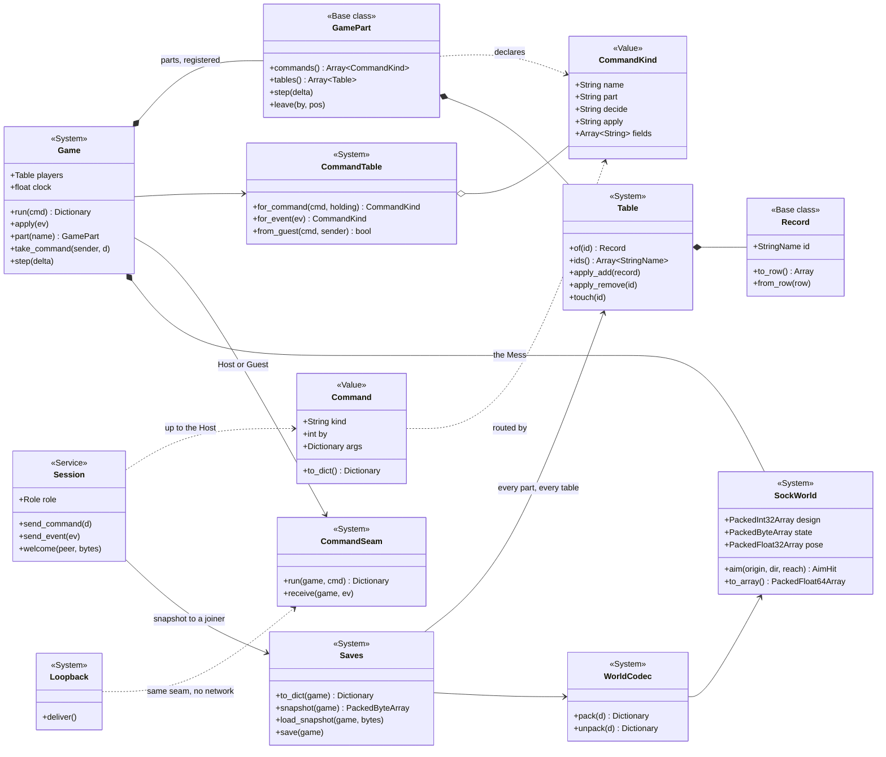
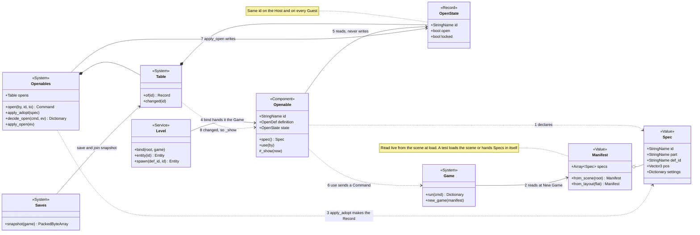
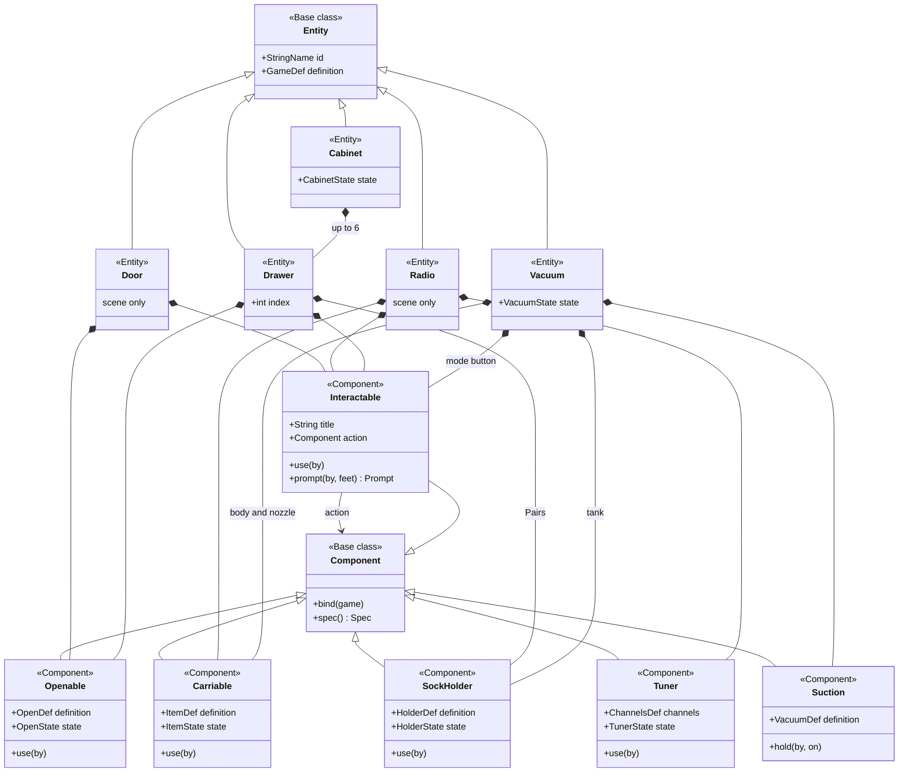
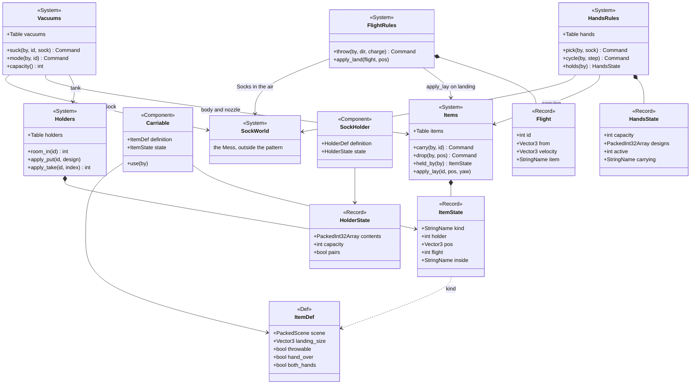
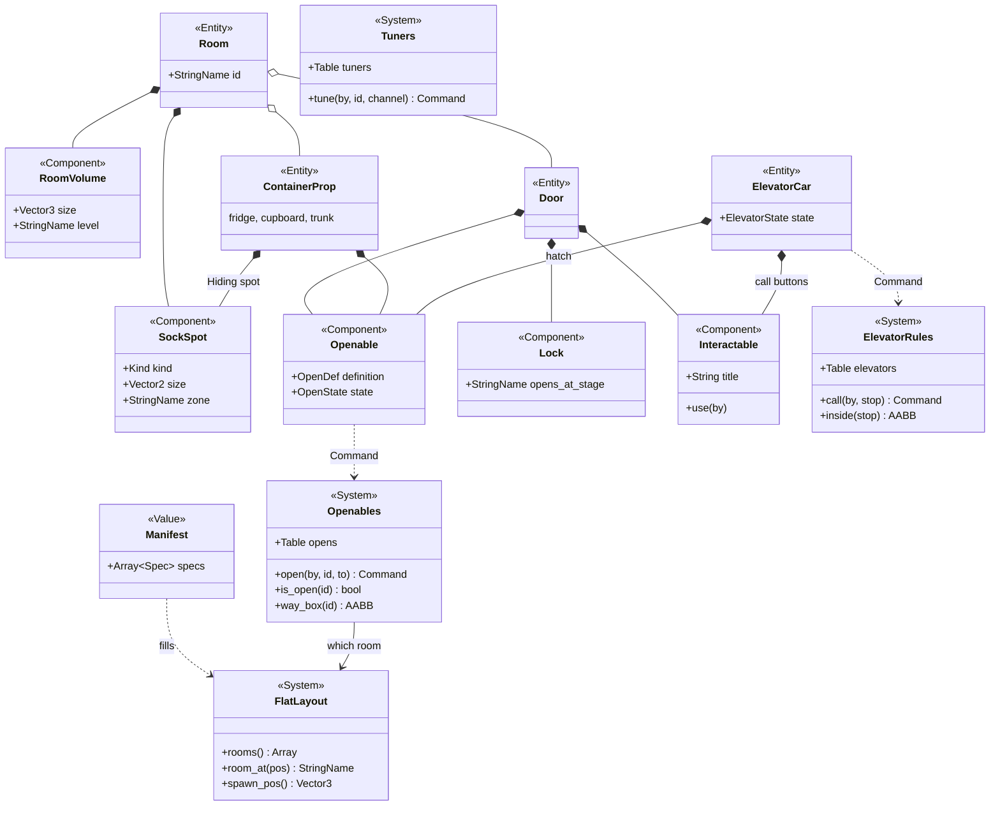
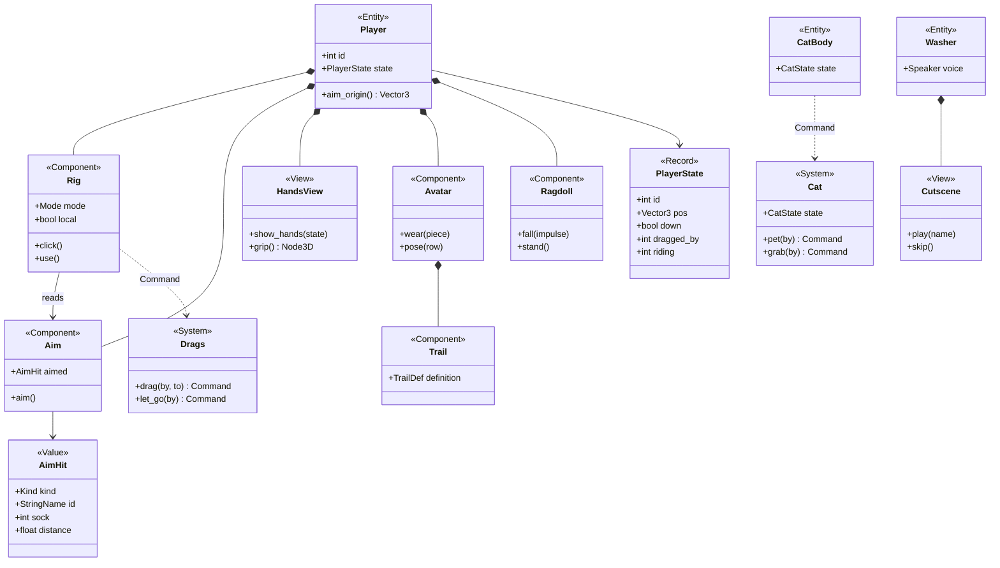
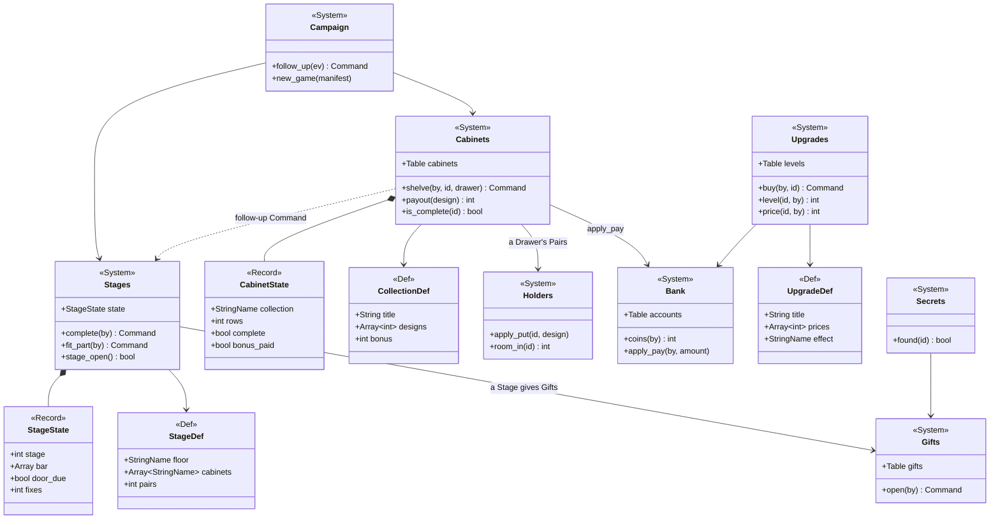
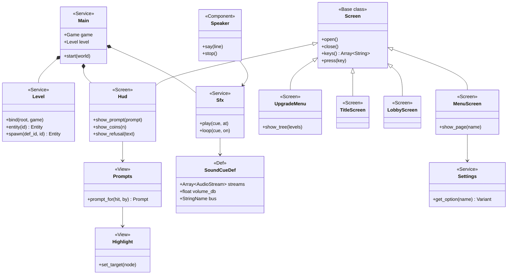
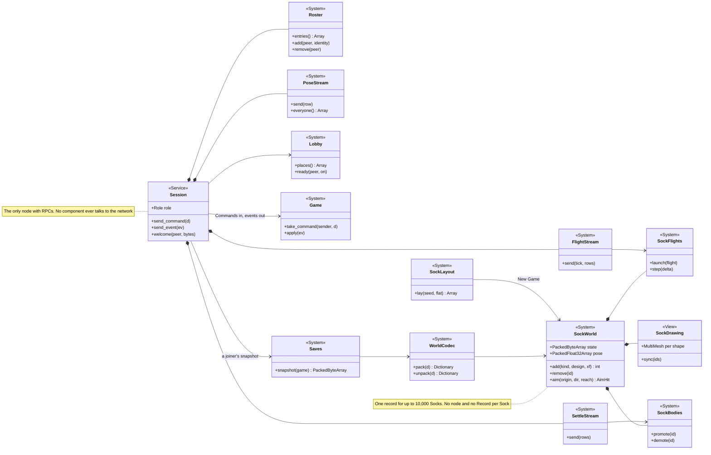

# The shape of the code after the move: kinds of class, one standard interface, the class list

Ticket maintenance/150. Read-only design research, 2026-11-19, `main` at 37ca272c. Nothing in the repo changed; nothing was run.
Builds on `top-down.md`, `move-plan.md`, the three slice reports, `authoring-and-editor-wiring.md` and `netcode.md`; it does not repeat them.
Data: `code-shape.json` beside this file. Diagrams: `diagrams/diagram-<n>-<slug>.mmd`, listed in `diagrams/diagrams.json`.

## Summary (15 lines)

1. Ten kinds of class, six of them with a base class: System, Record, Def, Entity, Component, Screen; plus View, Service, Value and "Base class" itself. The designer named three (object, component, base class); the other kinds are needed because Hands, Coins, Stages and 10,000 Socks have no node, and because numbers and screens are not objects in the house.
2. One standard interface, 30 numbered rules, most with a mechanical check. The heart of it: state is typed fields of a Record; anyone reads them; only a function named `apply_...` in a System writes them; the only public way to change the World is a Command.
3. The two-worlds answer: a hand-placed node declares (an id, an ability, its settings); a System adopts that declaration and keeps the state as a Record; the component reads that Record, shows it and asks for changes with Commands. One id joins the two.
4. The designer's new answer (tests may load scenes) removes one reason for node-free rules, not all. Still earned: Host authority with a write boundary a script can check, the save as the join snapshot, state for things without a node, rules across objects, the Mess. No longer needed: a baked copy of the scene for scene-free tests, readers as the only way a test may read.
5. Two shapes are defensible: (A) Records beside components, rules in Systems; (B) state and rules on the component with a generic snapshot. Both are sketched for the Door and the Radio. I pick A: it is today's rule files with typed state, it needs no change to ADR-0006, and it keeps "who may write" checkable. B saves about 10 classes and reads more like Unreal; section 4.3 says what would change my mind.
6. It works end to end for a Door, the Radio, a Cabinet with Drawers and the vacuum (sketches in section 4).
7. Outside the pattern, on purpose: the Mess and its MultiMesh, Socks and Pairs in the air, the Session and its streams, the Sock layout. They keep the interface's reading and Command rules, not the Entity and Record shape.
8. **113 classes.** By kind: System 33, Entity 17, Component 15, Record 13, Def 12, Base class 6, View 6, Value 5, Service 4, Screen 2. By status: reshaped 55, new 42, kept 16. Core: 56. Core loop: 52.
9. Six components carry most of the house: Interactable, Openable, Carriable, SockHolder, Tuner, Suction. A Door, the Radio, a Guide card, a Part and a Laundry bin are scenes with no script of their own.
10. Three generic Systems replace the per-kind chains: Items (15 carried kinds), Holders (Drawer, tank, hopper, bin), Openables (Doors, Drawers, lids, hatches). They may never name a kind; a script checks that.
11. Tests follow the designer's answer: behaviour and invariants first and most; the core loop (find, aim, pick, pair, carry, throw, open, shelve, Stage) heaviest; scenes tested by what must hold, not where things stand; layout pins allowed, few and apart.
12. That changes the move plan's test method: stored snapshots and reader files become tools, not gates; "no Sock lost", "every machine equal" and "a joiner equals the Host" run after every case.
13. The shape lands on the move plan's waves without reordering them: the base classes in wave 1, Items and Interactable in wave 2, Openables, Cabinets and Hands in wave 3, Holders with the vacuum in wave 4.
14. Prove first: self-encoding Records on one part; the Radio as one scene bound to its Record with a Guest joining in every state; a `@tool` component that names non-tool classes.
15. Outside reading was thin: only docs.godotengine.org answered. Nystrom, Gambetta, Fiedler, Valve, Unreal, Unity, Fowler and Wikipedia all returned HTTP 403; what I say of them is marked.

---

## 1. What the sources say

Godot pages are the 4.7 docs (`/en/stable/`, header "Godot Engine 4.7"), fetched today. "Repo" means quoted from `docs/research/nativize/maintainability.md`, whose author read the book's text on 2026-11-10. "Memory" means I could not fetch it today and state it from knowledge; treat as unverified.

| Pattern | What the source says | Its stated cost | Fits this game? |
|---|---|---|---|
| **A scene is a class** (Godot, what_are_godot_classes, scenes_versus_scripts) | "The scene is always an extension of the script attached to its root node." A game-specific concept "should always be a scene"; a reusable tool "should probably be a script". "The larger and more complex the node, the more reason there is to build it as a scene." | "Script code like this is much slower than engine-side C++ code" (building nodes in code). | Yes. An Entity is a scene; a Component is a reusable script. This is the 3,993 lines of build functions. |
| **Loose coupling, inject downwards** (Godot, scene_organization) | Five ways to hand a child what it needs: connect a signal, call a method, set a Callable, set a Node reference, set a NodePath. Signals are "extremely safe, but should be used only to 'respond' to behavior, not start it." Siblings: "an ancestor mediates their communications and references." | None stated; the page warns that a scene with outside needs must document them (a tool script with configuration warnings). | Yes. `bind(game)` is "set a reference"; a component's typed export to its Interactable is the same. Signals only report (rules 9, 10). |
| **Autoload only for a system that owns its data** (Godot, scene_organization, autoloads_versus_regular_nodes) | An autoload fits a system that "tracks all of its data internally", "should be globally accessible" and "should exist in isolation". Against a global manager: "one object is now responsible for all objects' data"; "there's no longer an easy way to find the source of a bug". Alternatives: a `class_name` node, a Resource for shared data, `static var`. | Global state, global access. | Yes: Settings and UiSounds stay autoloads; the Game is not one; Sfx stays a child of Main. |
| **Lighter than a node** (Godot, node_alternatives) | RefCounted is "useful in the majority of cases where one needs data in a custom class"; a Resource when the data should be saved and edited in the Inspector. "Nodes are cheap to produce, but even they have their limits." | | Yes: Record and System are RefCounted, Def is a Resource. |
| **Custom Resources** (Godot, resources, exports) | Over JSON: methods, signals, sub-resources, "Godot Engine's Inspector renders and edits Resource files out-of-the-box." A resource is loaded once and shared. An exported value is not readable in `_init`. | Shared instance: changing it changes every user (repo, godot-rules R1). | Yes, as Type Object: Defs are never written while playing (rule 19). |
| **Static typing** (Godot, static_typing, styleguide) | "GDScript can detect more errors without even running the code"; typed code uses "optimized opcodes". `UNTYPED_DECLARATION` and `UNSAFE_*` warnings exist and are off by default. No nested typed collections. Style: PascalCase classes, snake_case functions, past-tense signals, a fixed code order, underscore for private and virtual. | Typed arrays of arrays are not possible, so a Record's fields stay flat. | Yes (rule 12). |
| **GDScript has no private** (Godot, gdscript_basics) | Properties take `get` and `set`; inside its own accessor a variable reads its backing value. `@abstract` classes and methods exist since 4.5. The page names no private or protected keyword. | Read-only and "only apply writes" cannot be enforced by the language. | So the boundary is by name (`apply_`, `_`) and checked by script (rules 4, 6). |
| **`@tool`** (Godot, running_code_in_the_editor) | "Any other GDScript that your tool script uses must also be a tool." Freeing nodes in the editor "can cause crashes". `_get_configuration_warnings()` shows a scene's needs. | A component that shows editor warnings pulls its dependencies into the editor. | Components stay thin (rule 21); unverified whether naming a non-tool class as a type is enough (section 9). |
| **MultiMesh for many identical things** (Godot, using_multimesh; page marked not yet updated for 4.7) | "A single draw primitive that can draw up to millions of objects in one go"; instances are "always or never drawn" together; for thousands of things that need per-frame control, "using servers directly is the recommended optimization". | No per-instance culling. | The Mess stays what it is. |
| **Godot replication** (Godot, high_level_multiplayer, class MultiplayerSynchronizer) | RPC nodes "need to have the same NodePath"; "all RPCs in a script are checked at once". The Synchronizer "synchronizes properties from the multiplayer authority to the remote peers"; "not supported for Object type properties, like Resource". The class page says nothing about late joiners. "Treat all client input as untrusted." | Paths and RPC signatures become protocol. | Keep Commands and one RPC node (netcode.md already says so; nothing here changes it). |
| **Component** (Nystrom; repo) | Splits a class so that "we don't want AI, physics, rendering, sound and other domains to know about each other". | Indirection; components must talk to each other somehow (shared state on the owner, direct references, or messages), each with its own cost (memory). | Yes, with direct typed references inside one Entity and ids across Entities (rule 13). |
| **Command** (Nystrom; repo) | "We've decoupled the producer on one end from the consumer on the other." A command is a method call made into an object, so it can be queued, sent and replayed (memory). | Many small classes if each command is one. | Already the game's spine. Commands stay data plus a table, not a class each. |
| **Observer** (Nystrom; repo) | "Dead simple and it works." | "The only way to tell who will get notified is by seeing which observers happen to be in that list at runtime"; lapsed listeners. | Signals only report and never carry rules (rules 9, 10); Game stops growing signals. |
| **State** (Nystrom; memory) | Boolean flags that cannot all be true together should be one state with named transitions. | A flat state machine cannot hold two things at once or remember history. | The Rig's modes (walking, down, dragged, washed, riding) become one typed `mode`. An item's lying, held, flying is derived from its Record. |
| **Update Method** (Nystrom; repo) | Each object owns its per-frame behaviour. | State kept between frames, order dependence, changing the list while looping. | `step(delta)` only on Systems, in Game's fixed order; a component's `_process` is for looks. |
| **Type Object** (Nystrom; memory) | A kind of thing is data that instances point at, so designers add kinds without code. | Behaviour per kind is harder; the kind object must be found by hand. | Defs. The escape for behaviour is a component, not a `match` on the kind (rule 14). |
| **Service Locator, Singleton** (Nystrom; repo) | "A singleton is global state ... encapsulated in a class." A locator makes it "harder to understand what your dependencies are by reading the code". | Hidden coupling. | No locator. The Game is handed in. `Openables.on(game)` is a typed lookup on a thing you were given. |
| **Data locality** (Nystrom; memory) | Many identical things belong in contiguous arrays, not in objects found through pointers; profile first. | Gives up inheritance and per-object flexibility. | `SockWorld`'s packed arrays for 10,000 Socks. Nothing else in the game is numerous enough. |
| **Command-query separation** (Meyer, via Fowler; memory) | A function either changes state or returns an answer; asking must not change the answer. | Awkward for "take and return" operations. | Rule 7, with two named exceptions. |
| **Authoritative server** (Gambetta, Fiedler, Valve; memory) | Clients send intent, the server decides and sends state; state is replicated, not nodes; a client may predict its own actions and is corrected; a joiner gets a full snapshot. | Latency for the client; prediction needs rollback. | ADR-0006 as it stands. A Record is exactly "the state that is replicated". |
| **Actor and component with replicated properties** (Unreal; memory) | State lives on the actor's components; authority is checked in the component; marked properties replicate; cosmetic things run locally. | Rules and looks share a class; authority is a discipline. | This is shape B (section 4.3). Mainstream for scene-tree engines, and the reason B is defensible. |

What the sources agree on, in one paragraph: compose objects from small parts in the scene; keep data in the thing that owns it and hand dependencies downwards; let signals report and never command; make kinds data; keep the many-identical things in arrays; let one machine decide and replicate state, not nodes. They disagree with each other only on where a prop's state lives: on the object (Godot's "each scene manages its own state", Unreal) or in a separate world state (snapshot netcode). Section 4 takes that question on.

---

## 2. The standard interface

### 2.1 The rules

| # | Rule | How it is checked |
|---|---|---|
| 1 | State lives in Records. Everything the Host decides on, a save keeps or a late joiner must see is a field of a Record held in a Table of one System. Nothing of that kind is a field of a node, a Dictionary on Game or a static var. | tests/shape_test: Game has no state field besides its Tables and parts; the invariant 'a joiner equals the Host' (rule 27) fails for state kept anywhere else. |
| 2 | A Record is typed plain data. Every field has a type and a default; allowed types are bool, int, float, String, StringName, Vector3, Quaternion, packed arrays and typed arrays of those. No Node, Object, Callable, Resource or untyped Dictionary. It may hold questions about itself (is_full()), never rules. | tests/shape_test walks every script that extends Record, reads its property list and fails on any other type; a round trip from_row(to_row()) must give an equal Record. |
| 3 | Anyone may read. The game, a component, a view, a screen and a test read a Record's fields directly: system.of(id).open. A component offers its Record as a read-only field called state. | Review. Reading needs no permission, so there is nothing to check but rule 4. |
| 4 | Only apply writes. A Record's field is assigned only inside a function whose name starts with apply_, in a System. Not in decide, not in step, not in a component, view, screen or test. | tools/grep_rules.py: an assignment or a mutating call (append, erase, +=) on a Record field outside a function named apply_* in a file of kind System fails. Tests are scanned too. |
| 5 | Changes are Commands. The one public way to change the World is game.run(Command). A System gives each of its Commands a static constructor named as a verb (Openables.open(by, id, to)); decide_<kind>(cmd, ev) answers on the Host and changes nothing; apply_<kind>(ev) changes the Records on every machine from the event alone. | tests/command_table_test (exists): every kind has decide, apply, its fields and an example. New: after calling only decide_ on the example, the snapshot is unchanged. |
| 6 | Five sorts of function, told apart by name. On a System: a static verb makes a Command; decide_* and apply_<kind> are called only by the Command flow; apply_<effect> (apply_pay, apply_put) may be called by another System, and only from inside its own apply_; step(delta) is called only by Game; everything else public is a question that changes nothing. On any class: _name is private to its file. | grep_rules.py: apply_ and decide_ are called only from System files and the Command flow; '._' on another object fails (the statics and typed guards exist); a public function without apply_ in its name contains no Record assignment (rule 4). |
| 7 | Ask or change, never both. A function either returns an answer or changes state. The exceptions are game.run (it returns the Host's event) and Table.apply_take (it returns what it took). | Review; rule 4's check catches a question that writes. |
| 8 | Host-only work goes through a Command. A timer, a physics trigger or a step that changes the World runs on the Host only, inside System.step, and its result is a Host-only Command. No is_host() test in a component, view or screen. | grep_rules.py: is_host( allowed only in System and Service files (304 mentions today). |
| 9 | Signals say what happened, in the past tense, with ids and plain values, never objects. A Table says added, changed and removed; a System adds signals for happenings that are not state (a cue, a payout). They are emitted only inside apply_. Game keeps applied, refused, cue and cue_at and gains no more. | grep_rules.py: .emit( on a System signal outside apply_* fails; a signal argument typed as a Node or Record fails; signal count on Game is pinned. |
| 10 | A handler only shows or asks. A function connected to a signal may change what is drawn and heard, or call game.run. It never writes a Record and never decides. A signal wired in the editor stays inside its own scene and is for looks only. | Rule 4's check; a scene test fails on a [connection] line that leaves the scene. |
| 11 | Names. One class_name a file, the file is the class in snake_case. A System is a plural noun (Items, Cabinets); a Record ends in State; a Def ends in Def; a Component is the ability (Openable, Carriable, SockHolder); a View ends in View; a Screen ends in Screen or Menu. Words come from GLOSSARY.md (SockDetector, not Beeper). | tests/shape_test: file name matches class_name; suffix matches the base class. |
| 12 | Everything is typed. Every field, parameter and return has a type; := only where the type is on the same line. Dictionaries only for a Command's args and an event on the wire. Code order follows the GDScript style guide; every public member has a ## comment in glossary words. | tests/typed_test (exists) plus the UNTYPED_DECLARATION and UNSAFE_* warnings as errors. |
| 13 | A class knows only what its kind may know (the table in section 3). A System never names a node class. A component never names another Entity's component: it reaches other things by id through the Game. A class gets its Game handed in (bind(game) for nodes, _init(game) held weakly for Systems); there is no global lookup. | tests/layers_test (exists) extended: the kind is read from the base class and each reference is checked against the table. |
| 14 | Generic means generic. Items, Holders, Openables, Aim, HandsView and FlightsView never name a kind of thing: no match on kind, no if is_radio. A thing differs through its Def or by adding a component. | grep_rules.py: in those files, 'match' on a kind or def id, or a Def id literal, fails. |
| 15 | Inheritance stays shallow. At most two project classes between an engine class and a concrete one (Component, then Openable; Entity, then Cabinet). Before a third level, add a component or a Def field. | tests/shape_test computes the depth of every class_name. |
| 16 | Every Entity has an id. id is an exported StringName, unique in the World and never a node path. A hand-placed thing gets its id from the author; a thing made while playing gets it from the Host in the event. A component's Record has the Entity's id, or id/part when an Entity has two of one component (vacuum/nozzle). | Scene invariants (rule 28) and an editor warning: empty or duplicate ids. |
| 17 | Saving and joining are free. A System lists its Tables in tables(); Saves loops over every part's Tables; the same rows are the save and the join snapshot. No class writes its own to_dict or load_dict. A field in a Record's transient() list is in the snapshot and not in the save. | grep_rules.py: 'func to_dict' and 'func load_dict' outside Record, Table, Saves and the Mess fail. Invariant: load(save(World)) equals the World. |
| 18 | Leaving is declared. What happens to a System's things when a player leaves, and how a save lays down what a Guest holds, is that System's leave(by, pos). | Behaviour case per carried kind: leave while carrying. |
| 19 | Numbers live in Defs. A balance number, a size or a time is an exported field of a Def (.tres), never a literal in code and never a string key. A Def is not changed while playing; an Upgrade's effect is a question on a System (Vacuums.capacity()). | grep_rules.py: tuning.num( in a moved feature fails; an assignment to a Def field outside the editor fails. |
| 20 | An Entity scene has one shape. The root is the Entity with id and definition; a child called Model is the plain glb instance; each component is a direct child named after its class; places are Marker3D children with unique names (%Grip). No script on Model, no state in the scene file but starting values. | problems(root) of the Entity base, run by the scene invariants (rule 28) and shown as editor warnings. |
| 21 | A component is small and does four things. It declares (exports and spec()), reads (state), asks (use(by) sends a Command) and shows (_show(now) is the only place that touches child nodes, tweens and sounds). now is true when the state arrives whole (load, join) and false when it changes. | grep_rules.py: get_node, $, % and create_tween in a component outside _show, _bound and _ready fail; file length over 200 lines is reported. |
| 22 | A component may keep what is only for looks. How far a swing has got, which clip plays, a flicker. The test: if a late joiner would be wrong without it, it is state and belongs in a Record. | The joiner invariant (rule 27). |
| 23 | No debug or test hooks in game classes. No demo_ function, no test knob, no static var except a cache. A test uses the game's own entrances (Q2056). | tests/statics_test (exists); grep for demo_ and TEST_KNOBS. |
| 24 | A test is a rule about behaviour. It acts through game.run, a real input on the Rig or a Loopback line, and it asserts an outcome: what was granted or refused, what a Record says, a count, that a thing can be reached and used. Most cases are of this sort. | Review of the case list in the feature's contract; the share of behaviour cases per suite is printed by tools/run.sh. |
| 25 | The core loop is tested most. Find, aim, pick, pair, carry, drop and throw, hand over, open, shelve, the Stage moving on: each behaviour has cases alone, as a Guest, with two players racing, and with a Guest joining halfway. The classes that carry it are marked core_loop. | tools/testgraph.py reports cases per core-loop behaviour; a behaviour with fewer than its four variants is listed. |
| 26 | Tests find things by what they are, not where they are. A case asks for 'a shut Door', 'a Drawer with room', 'a Sock in reach', through tests/facts.gd, so a rearranged scene keeps it green. Node names, child indexes, private members and debug-panel buttons are never test handles. | grep in tests/: get_node, get_child, '._', zoo buttons fail in a behaviour suite (Q2056). |
| 27 | Invariants run on every case. After each case the runner checks, at no cost to the author: no Sock or Pair is lost (the Mess, Hands, holders, flights and Drawers add up to what was dealt); every thing is in exactly one place; Coins paid equal Coins earned; every machine has the same World; a Guest who joins now has the Host's World; a save loaded again is the same World. | A hook in tests/runner.gd; a case may switch one off only with a reason. |
| 28 | An authored scene is tested by what must hold, not by where things stand. For every scene: ids unique and not empty; problems(root) is empty; every Interactable can be reached by the crosshair from somewhere a player can stand and answers use() with a grant or a refusal; every Door and Drawer opens and shuts; every Drawer takes a Pair; every SockSpot lies inside a room; the Cat can walk to every room; the Mess laid on it rests inside the house and every Sock can be picked. | tests/scene_invariants_test walks every scene under scenes/; new scenes are covered without a new case. |
| 29 | Layout pins are allowed and are not the point. A test may pin a position, a count of spots or a stored snapshot where that is the handy way to catch a slip. Pins live apart from behaviour cases (their own suite or a pin mark), are few, and are renewed by one command when the designer moves things. Stored snapshots and golden files are tools, used the same way. | tools/run.sh --repin rewrites the stored values; a behaviour suite that fails after a scene edit with no rule changed is a defect of the suite. |
| 30 | One whole-loop run on the shipped house. A scripted player plays from New Game to the first Stage done on the real scenes with a fixed seed, as Host and with a Guest, checking the invariants at every step. It proves the loop can be played, not where anything is. | One slow case, run at every merge. |

### 2.2 The template: a System with its Record, and a Component

The templates are real: they are the Door (section 4.2 uses them as they stand).

```gdscript
## The state of one thing that opens. Fields only; every one typed, with a default.
class_name OpenState
extends Record

var open := false
var locked := false
```

```gdscript
## Things that open: room Doors, Drawers, lids, hatches. One OpenState each, by id.
class_name Openables
extends GamePart

## `id` was opened or shut by player `by` (after the state changed).
signal opened(id: StringName, by: int)

var opens := Table.new(OpenState)


static func on(game: Game) -> Openables:
	return game.part(&"openables") as Openables


static func commands() -> Array[CommandKind]:
	return [CommandKind.of("open", "openables", "decide_open", "apply_open").carries(["id", "open"])]


## Player `by` turns `id` open (`to`) or shut.
static func open(by: int, id: StringName, to: bool) -> Command:
	return Command.new("open", by, {"id": id, "open": to})


func tables() -> Array[Table]:
	return [opens]


## Whether `id` stands open. A question: it changes nothing.
func is_open(id: StringName) -> bool:
	var s := opens.of(id) as OpenState
	return s != null and s.open


## The Host's answer. Reads, never writes.
func decide_open(cmd: Command, ev: Dictionary) -> Dictionary:
	var s := opens.of(StringName(cmd.args["id"])) as OpenState
	ev.merge({"id": cmd.args["id"], "open": bool(cmd.args["open"])})
	if s == null:
		ev["reason"] = "wrong"
	elif s.locked:
		ev["reason"] = "locked"
	else:
		ev["ok"] = true
	return ev


## Every machine: the only place an OpenState changes.
func apply_open(ev: Dictionary) -> void:
	if not ev["ok"]:
		if ev["reason"] == "locked":
			game.refuse(int(ev["by"]), "Locked")
		return
	var s := opens.of(StringName(ev["id"])) as OpenState
	s.open = bool(ev["open"])
	opens.touch(s.id)
	opened.emit(s.id, int(ev["by"]))
```

```gdscript
## The ability to be opened and shut. Add it to an Entity, point it at what moves.
@tool
class_name Openable
extends Component

@export var definition: OpenDef
@export var starts_open := false
@export var moving: Node3D

## Read-only: the Record the rules keep for this thing.
var state: OpenState:
	get:
		return _state
var _state: OpenState
var _amount := 0.0


## What this node declares to the rules (read once, at New Game).
func spec() -> Spec:
	return Spec.of(self, &"openables", {"starts_open": starts_open})


func _bound() -> void:
	_state = Openables.on(game).opens.of(id) as OpenState
	Openables.on(game).opens.changed.connect(_on_changed)
	_show(true)


## Asked by the Interactable when a player uses it. Sends a Command, changes nothing.
func use(by: int) -> void:
	game.run(Openables.open(by, id, not _state.open))


func prompt(_by: int, _feet: Vector3) -> Prompt:
	return Prompt.of(("Shut the %s" if _state.open else "Open the %s") % definition.noun, ["key_e"])


func _on_changed(changed_id: StringName) -> void:
	if changed_id == id:
		_show(false)


## The only place that moves nodes. `now`: the state arrived whole (load, join), so no swing.
func _show(now: bool) -> void:
	var to := 1.0 if _state.open else 0.0
	if now:
		_place(to)
	else:
		create_tween().tween_method(_place, _amount, to, definition.swing_time)
```

A class of any kind reads the same way from top to bottom: what it is (`##`), signals, exports (what an author sets), state (what anyone may read), Command makers, questions, `decide_`, `apply_`, private helpers.

### 2.3 Smells: what a reviewer sends back

- A field on a node that another machine would need (a late joiner would be wrong without it).
- A Record field assigned outside an `apply_` function; a test that sets a field to arrange its case instead of running Commands.
- `match kind`, `if is_radio`, a Def id literal inside Items, Holders, Openables, Aim, HandsView or FlightsView.
- A new field, forward or signal on Game; a new line in a list of parts.
- `is_host()` in a component, a view or a screen.
- A signal handler that decides something; a signal that carries a node.
- A component that calls another Entity's component, or finds things with `get_node("../..")`, `get_parent().get_parent()` or `set_meta`.
- A `to_dict`, `load_dict` or a positional row written by hand.
- `tuning.num("...")`, a balance number or a size as a literal in moved code; a "glb or placeholder" fallback.
- A subclass made to change one number or one sound; a third level of inheritance.
- `demo_` functions, test knobs, a zoo button as a test's handle (Q2056); a test that finds its subject by node name or child index.
- A behaviour suite that goes red when the designer moves a piece of furniture.
- A new autoload or Service without a decision.
- Dictionary-typed state ("a small extra Dictionary"); an untyped parameter.

---

## 3. The kinds of class

| Kind | In Godot | Use it when |
|---|---|---|
| **System** | RefCounted (extends GamePart when it owns Commands or state); no node | It decides something for the whole World, or owns state that has no node of its own (Hands, Coins, Stages, every Sock), or its rule spans several objects. The only kind that writes a Record. |
| **Record** | RefCounted (extends Record) | It is the state of one thing: typed fields with defaults and small questions about them, nothing else. If a late joiner must see it, it is a Record. |
| **Def** | Resource (extends GameDef), saved as .tres | It is what a kind of thing is and its numbers: shared by every instance, edited in the Inspector, never changed while playing (Nystrom's Type Object). |
| **Entity** | Node3D or a body, the root of a scene (extends Entity) | It is an in-game object you can point at in the house. Its scene is a Model plus components. It gets its own script only when it does something no component does (the designer's first kind). |
| **Component** | Node, Node3D, Marker3D or StaticBody3D, a child of an Entity (extends Component) | It is one ability an Entity has (can be opened, carried, aimed at, holds Socks) that at least two different Entities need, or that an author should be able to add in the editor (the designer's second kind). |
| **Base class** | @abstract class_name; one for each of System, Record, Def, Entity, Component, Screen | Two or more classes share the same members and one caller treats them alike (the designer's third kind). Never made only to share helper functions: those are static functions on a Value class. |
| **View** | Node, Node3D or Control with no Record of its own | It draws state that has no Entity (the Mess, things in the air, what the Hands hold) or plays a timeline. It reads and shows; it never asks for a change. |
| **Screen** | Control scene (extends Screen) | It is a menu or the HUD. It reads state, and a button may send a Command. |
| **Service** | A child of Main, or an autoload when it tracks only its own data | It is needed by many features and belongs to the machine, not to the World: Main, Level, Session, Sfx, Settings. Kept few; each new one is a designer or lead decision. |
| **Value** | RefCounted, made and passed, never kept as state | It is a message or an answer: Command, CommandKind, Spec, Manifest, AimHit, Prompt. |

**How to choose, in order.** (1) Is it a number, a size, a look or a list a designer tunes? Def. (2) Must a late joiner see it? Its fields are a Record. (3) Does it decide, or change Records? System. (4) Can you point at it in the house? Entity, made of components. (5) Is it an ability two different Entities need? Component. (6) Does it only draw or play? View, or Screen for a menu. (7) Is it per machine and needed everywhere? Service, and ask first. (8) Is it a message? Value.

**Why more than the designer's three.** The designer named the in-game object, the component and the base class. Three more exist because of what this game is: a System, because the Hands, the Coins, the Stage and every Sock have no node, and because a rule such as shelving touches Hands, a Drawer, the Coins and the Stage at once; a Record, because the Host's truth has to be something a save and a joiner can receive whole; a Def, because a kind's numbers are shared and edited, not coded. View, Screen, Service and Value are the usual rest of any Godot project and are kept apart only so the "who may know whom" table can be checked.

**Who may know whom.** A row may name a column. "read" means read fields and call questions; "ask" means make and run Commands.

| may name → | Value | Def | Record | System | Component | Entity | View | Screen | Service |
|---|---|---|---|---|---|---|---|---|---|
| **Value** | yes | yes | no | no | no | no | no | no | no |
| **Def** | yes | yes (and scenes) | no | no | no | no | no | no | no |
| **Record** | yes | by id only | no | no | no | no | no | no | no |
| **System** | yes | yes | writes its own, reads others | questions and `apply_` effects, through the Game | no | no | no | no | no |
| **Component** | yes | yes | read | read, ask | its own Entity's, by typed export | its own | its own child visuals | no | no (signals up) |
| **Entity** | yes | yes | read | read, ask | its own | its children | its own | no | no |
| **View** | yes | yes | read | read | no | no | yes | no | no |
| **Screen** | yes | yes | read | read, ask | no | no | yes | yes | Settings |
| **Service** | yes | yes | read | yes (Main and Level compose; Session hands Commands and events to Game) | binds | binds, spawns | yes | yes | yes |

---

## 4. One object in both worlds

### 4.1 What is still earned, after the designer's answer on tests

The designer, 2026-11-19: tests may run on the authored scenes; what matters is that things work, not that rules can run without a scene. So "the rules must be node-free so tests need no scene" is no longer a reason. I went through the other reasons one by one.

| Reason for keeping state and rules apart from nodes | Still earned? |
|---|---|
| **The Host decides; a Guest cannot.** | Yes, but it needs only that state is separate from looks and that one function family writes it. It does not need "no nodes". What it does need is a boundary a script can check; "only `apply_` in a System file" is that boundary. |
| **The save is the join snapshot.** | Yes. All state must be listable and encodable in one loop. Tables give that without walking a tree. A walk over components could give it too (shape B). |
| **A late joiner.** | Yes, and it favours state that can be loaded before or while the scene loads, and that exists for a thing whose node is hidden or not made yet. |
| **Things with no node.** Hands, Coins, Drawers (the currency), Stages, Upgrades, players, Pairs on the floor, every Sock. | Yes. These are Records in Systems in any shape. |
| **Rules across objects.** Shelving, a Door pushing Socks, the vacuum taking from the Mess. | Yes. They need a home that is not one of the objects. |
| **10,000 Socks.** | Yes. Forced by ADR-0008. |
| **Rule tests without a scene.** | No longer a requirement. It stays possible and cheap in shape A (a test may hand Specs in itself), which is a convenience, not a reason. |
| **Several machines in one test process.** Today's Loopback cases build two or three Games side by side. | A real convenience of shape A: three Games are three small objects. With state on nodes each machine needs its own copy of the scene and its own physics space. Not decisive now that scenes may be loaded. |

What folds into the nodes now, in either shape: which things exist, their ids, their settings and starting state (the scene is the only source; no JSON, no installer); every prompt and title; the call that makes the Command; all looks. What I dropped from my first design because of the answer: a baked copy of each scene for scene-free tests; the rule that tests may read only through reader files.

### 4.2 The answer (shape A), in steps

1. **Declare.** An author adds a component node to an Entity scene and sets its exports. The Entity carries `id`. The component's `spec()` says, as plain data: this id, this ability, this Def, these settings.
2. **Read once.** At load, `Manifest.from_scene(root)` walks the scene and collects every Spec. (Until the house is scenes, `Manifest.from_layout(flat)` gives the same Specs from today's JSON. That is what lets the house move last.)
3. **Adopt.** At New Game on the Host, each System takes the Specs addressed to it and makes a Record (`apply_adopt`). A Guest and a loaded save get the Records from the snapshot instead. A thing made while playing (a vacuum bought, a Gift box) goes the other way: the Host's event makes the Record, and `Level.spawn` instances the Def's scene for it on every machine.
4. **Bind.** `Level.bind(root, game)` hands every component the Game. The component looks up its Record by id and keeps it as its read-only `state`.
5. **Ask.** A player uses the thing: the Rig's Aim finds the `Interactable`, which calls `use(by)` on its action component, which runs a Command. Nothing else happens on a click.
6. **Decide and apply.** The Host's System decides; every machine applies; the Record changes; the Table says `changed(id)`.
7. **Show.** The component's `_show(false)` animates. On a join or a load every component gets `_show(true)` and snaps to its state.

The same seven steps for the four cases follow. The Door is the template of section 2.2 as it stands; its Door scene is:

```
Door_WorkshopLobby (Entity)        id = &"Door_WorkshopLobby", definition = door.tres
  Model (door.glb)
  Interactable (StaticBody3D)      title = "Door", action = ../Openable
    Shape (CollisionShape3D)
  Openable                         definition = door.tres, moving = ../Model, starts_open = false
  Lock                             opens_at_stage = 2        (only on a locked door)
```

A Door that pushes what lies in its way keeps doing so in the rule: `apply_open` calls `SockWorld.apply_push(way_box(id))` and `Items.apply_push(...)`, as `DoorRules.push_from` does today.

**The Radio: a carried thing with a state of its own.** Scene: `Radio (Entity)`, `Model`, `Interactable` (action = Carriable), `Carriable` (definition = radio.tres), `Dial (Interactable)` (action = Tuner), `Tuner`, `Speaker`, `%Grip`. Two Records with one id: an `ItemState` in Items and a `TunerState` in Tuners.

```gdscript
# in Items (extends GamePart): one rule for every carried kind. It never names a kind.
func decide_carry(cmd: Command, ev: Dictionary) -> Dictionary:
	var it := items.of(StringName(cmd.args["id"])) as ItemState
	ev["id"] = cmd.args["id"]
	if it == null or not it.is_lying():
		ev["reason"] = "gone"  # a teammate has it, or it is in the air (first to arrive wins)
		return ev
	var def := game.defs.of(it.kind) as ItemDef
	if def.owner_only and it.owner != cmd.by:
		ev["reason"] = "wrong"
	elif not HandsRules.on(game).takes(cmd.by, def):
		ev["reason"] = "full"
	else:
		ev["ok"] = true
	return ev


func apply_carry(ev: Dictionary) -> void:
	var by := int(ev["by"])
	if not ev["ok"]:
		if ev["reason"] == "full":
			game.refuse(by, "Hands full")
		return
	var it := items.of(StringName(ev["id"])) as ItemState
	it.holder = by
	it.flight = -1
	HandsRules.on(game).apply_carry(by, it.id)
	items.touch(it.id)
	taken.emit(it.id, by)
	game.cue.emit(by, "pick")
```

```gdscript
# in Carriable (extends Component)
func use(by: int) -> void:
	game.run(Items.carry(by, id))


func _show(now: bool) -> void:
	var entity := get_parent() as Entity
	if _state.is_held():
		entity.visible = false  # the holder's HandsView shows definition.scene at its %Grip
	elif _state.is_flying():
		entity.visible = false  # FlightsView shows it until it lands
	else:
		entity.visible = true
		var to := Transform3D(Basis(Vector3.UP, _state.yaw), _state.pos)
		if now:
			entity.global_transform = to
		else:
			ItemPut.glide(entity, to, definition.put_time)
```

The channel is `Tuners.tune(by, id, channel)` and `Tuner._show`, the same shape again. Today the Radio is four fields on Game, `radio_rules.gd`, a `Carriable` inner class, a `Hands` constant, branches in `HeldView`, `ThrownItem`, `Flights`, `Landings` and `rig_click`, and half of `Device`.

**A Cabinet with Drawers: holds Pairs, progression pays out.** Scene: `Cabinet (Entity, id = the spot)`, `Model`, six `Drawer (Entity, id = cabinet/0..5)` each with `Interactable`, `Openable` (slides) and `SockHolder` (takes Pairs, shows them at `%Slot` markers). Which Collection stands here is drawn for the run, so it is state (`CabinetState.collection`), not an export. One Command, three Systems changed inside one event:

```gdscript
# in Cabinets (extends GamePart)
func decide_shelve(cmd: Command, ev: Dictionary) -> Dictionary:
	var cab := cabinets.of(StringName(cmd.args["id"])) as CabinetState
	var held := HandsRules.on(game).pairs_of(cmd.by, cab.collection)  # Designs of this Collection
	ev.merge({"id": cab.id, "designs": PackedInt32Array(), "into": PackedInt32Array(), "pay": 0})
	if held.is_empty():
		ev["reason"] = "no_pairs"
		return ev
	var room := _room_by_drawer(cab)  # counted once; the Host fills from the aimed Drawer on
	var drawer := int(cmd.args["drawer"])
	for design: int in held:
		drawer = _next_with_room(room, drawer)
		if drawer < 0:
			break
		room[drawer] -= 1
		ev["designs"].append(design)
		ev["into"].append(drawer)
		ev["pay"] += payout(game.catalogue.design(design))
	ev["ok"] = not ev["designs"].is_empty()
	if not ev["ok"]:
		ev["reason"] = "full"
	return ev


func apply_shelve(ev: Dictionary) -> void:
	var by := int(ev["by"])
	if not ev["ok"]:
		game.refuse(by, "Drawers full" if ev["reason"] == "full" else "No Pairs for this Cabinet")
		return
	var cab := cabinets.of(StringName(ev["id"])) as CabinetState
	for i in ev["designs"].size():
		HandsRules.on(game).apply_take_pair(by, ev["designs"][i])
		Holders.on(game).apply_put(drawer_id(cab.id, ev["into"][i]), ev["designs"][i])
		pair_shelved.emit(by, cab.id, ev["into"][i], ev["designs"][i])
	Bank.on(game).apply_pay(by, int(ev["pay"]))
	cab.complete = is_complete(cab.id)
	cabinets.touch(cab.id)
```

The Stage moving on stays a follow-up Command from the Host (`Campaign.follow_up(ev)`), as today. On each machine the Drawer's `SockHolder` hears `Holders.put`, its `Openable` slides out, the Hud hears `Bank.paid`. The Drum hatch stays a Cabinet scene with another Model (ADR-0012).

**The vacuum: two carried parts, holds Socks, takes from the Mess.** Scene: `Vacuum (Entity, id = vacuum:0)`, `Model`, `Carriable` (the body), `Nozzle (Node3D)` with a second `Carriable` (record id `vacuum:0/nozzle`) and `Suction`, `Tank (SockHolder)` (record id `vacuum:0/tank`), `ModeButton (Interactable)`, `Hose (HoseRope)`, markers `%Outlet`, `%Hook`, `%Port`. Four Records: two `ItemState`, one `HolderState`, one `VacuumState` (mode, spitting). What only the vacuum does stays in `Vacuums`:

```gdscript
# in Vacuums (extends GamePart)
func decide_suck(cmd: Command, ev: Dictionary) -> Dictionary:
	var id := StringName(cmd.args["vacuum"])
	var sock := int(cmd.args["sock"])
	var nozzle := Items.on(game).of(part_id(id, &"nozzle"))
	ev.merge({"vacuum": id, "sock": sock, "from": cmd.args["from"]})
	if nozzle == null or nozzle.holder != cmd.by:
		ev["reason"] = "wrong"
	elif not game.world.is_loose(sock):
		ev["reason"] = "gone"  # a teammate picked it first
	elif Holders.on(game).room_in(part_id(id, &"tank")) <= 0:
		ev["reason"] = "full"
	else:
		ev["design"] = game.world.design_of(sock)
		ev["ok"] = true
	return ev


func apply_suck(ev: Dictionary) -> void:
	if not ev["ok"]:
		return
	game.world.apply_remove(int(ev["sock"]))  # leaves the Mess
	Holders.on(game).apply_put(part_id(ev["vacuum"], &"tank"), int(ev["design"]))
	sucked.emit(ev["vacuum"], int(ev["by"]), int(ev["design"]), ev["from"])
```

```gdscript
# in Suction (extends Component), on the nozzle: holding the button asks, at the Def's pace
func hold(by: int, on: bool) -> void:
	_by = by if on else -1


func _physics_process(delta: float) -> void:
	_wait -= delta
	if _by < 0 or _wait > 0.0:
		return
	var sock := game.world.loose_in_cone(global_position, -global_basis.z, definition.reach, definition.cone_deg)
	if sock >= 0:
		_wait = Vacuums.on(game).suck_interval()
		game.run(Vacuums.suck(_by, get_parent_entity().id, sock, game.world.pos_of(sock)))
```

Carrying the body and the nozzle, putting them down, a player leaving while holding either, and both rows of the save are Items' and cost the vacuum nothing. The hose's length is one check in `Items.decide_drop` asked of the kind's Def (`tether`), and the walking limit is the view's. The spit stream is `Vacuums.step` on the Host sending Host-only Commands. A Guest's own suck is predicted where it is declared today (`CommandKind.predicted`), in the System, not in the component.

### 4.3 The other defensible shape (B), and which I pick

**Shape B: the state and the rule live on the component; a generic snapshot walks the components.** Systems remain only for what has no node and for rules across objects.

```gdscript
## Shape B. The Door's ability, its state and its rule in one class.
class_name Openable
extends Component

@export var definition: OpenDef
## State. Listed in state_fields(), so it is saved and sent to a joiner.
@export var open := false
var locked := false


static func commands() -> Array[CommandKind]:
	return [CommandKind.of("open", "Openable", "decide_open", "apply_open").carries(["id", "open"])]


func state_fields() -> Array[StringName]:
	return [&"open", &"locked"]


func use(by: int) -> void:
	game.run(Command.new("open", by, {"id": id, "open": not open}))


func decide_open(cmd: Command, ev: Dictionary) -> Dictionary:
	ev.merge({"id": id, "open": bool(cmd.args["open"]), "ok": not locked})
	if locked:
		ev["reason"] = "locked"
	return ev


func apply_open(ev: Dictionary) -> void:
	if not ev["ok"]:
		return
	open = bool(ev["open"])
	game.world.apply_push(way_box())
	_show(false)
```

```gdscript
## Shape B. The Radio's place is four fields on its Carriable; the carry rule is here too.
class_name Carriable
extends Component

@export var definition: ItemDef
var holder := -1
var pos := Vector3.ZERO
var yaw := 0.0
var flight := -1


func decide_carry(cmd: Command, ev: Dictionary) -> Dictionary:
	if holder >= 0 or flight >= 0:
		ev["reason"] = "gone"
	elif not HandsRules.on(game).takes(cmd.by, definition):
		ev["reason"] = "full"
	else:
		ev["ok"] = true
	return ev


func apply_carry(ev: Dictionary) -> void:
	if ev["ok"]:
		holder = int(ev["by"])
		HandsRules.on(game).apply_carry(holder, id)
		_show(false)
```

The Command flow routes a Command to the component with that id instead of to a part. `Saves` walks `Level`'s components in id order and writes each one's `state_fields()`; a joiner loads the scene, spawns what the snapshot lists, then sets the fields and calls `_show(true)`.

| | A: Records beside components | B: state and rule on the component |
|---|---|---|
| Classes for a new ability | 3 small (Component, Record, System), often 2 when an existing System serves | 1 |
| Reads like | today's rule files; snapshot netcode | Unreal's actor components; Godot's "each scene manages its own state" |
| Host authority | "Only `apply_` in a System file writes" is a file-level check | Same naming rule inside one file; the looks and the state sit side by side, so a slip (`open = true` in a handler) is one line away |
| Save and join | Tables, loaded with or before the scene; a row may exist with no node | A walk; the scene first, then the rows; a thing must have a node to have state |
| Things without a node (Hands, Coins, Stage, Pairs, Socks) | Same pattern as everything else | A second pattern beside the first |
| Carried things | Radio and floor Pair are both `ItemState` rows, one rule | The Radio's state is on its node, a Pair has no node: two paths, or a node for every Pair |
| Rules across objects | Systems call each other's `apply_` effects | A System reaches into components' `apply_` effects |
| Co-op tests in one process | Cheap: Games are data | One scene and one physics space per machine |
| `@tool` | Components stay thin | The rule is in a script the editor may load; needs guards |
| ADR-0006 | Unchanged | Amended: "rules are node-free" becomes "rules never touch looks" |
| Migration from today | Rule files keep their shape; Dictionaries become Records | Every single-object rule moves into a node script |
| What the designer asked for ("a class has fields you can read, changed by commands and functions") | True of the System and its Record together; the component shows the same fields as `state` | True of one class, literally |

**I pick A.** The deciding points: carried things include Pairs, which must stay data, so B splits the busiest rule of the core loop in two; the write boundary is the thing that keeps co-op correct when agents write the code, and A's can be checked by file; and A is the smaller change from code that already passes 30,000 checks. What A costs is one or two more small classes per ability, and that the state of a Door is not literally a field of the Door's node, only readable through it.

**What would change my mind.** If the Radio spike shows that a new ability in A needs edits in more than three files, or that authors keep wanting to see and set live state in the Inspector on the node itself, build the Openable both ways (about 60 lines each) and compare. The first wave is the same for both shapes (Record, self-encoding, the part interface, `Level.bind`), so the choice can wait until then without waste. It is designer question 1.

### 4.4 What stays outside the pattern, and why

| What | Why it is not Entity, Component and Record | What it still obeys |
|---|---|---|
| **The Mess** (`SockWorld`, bodies, colliders, drawing) | Up to 10,000 Socks: no node and no object each (ADR-0008). State is packed arrays by id, drawn by MultiMesh, only a budgeted few are Jolt bodies. | Read by anyone through questions (`pos_of`, `design_of`, `aim`); changed only by `apply_` functions called from Systems; one save encoding (`WorldCodec`). |
| **Pairs on the floor** | A Pair is an `ItemState` row (so one carry, drop and throw rule serves it), but it has no Entity: `FloorBalls` draws all of them. A component cannot be added to one Pair. | Everything a Record obeys. |
| **Things in the air** (`Flight`, `SockFlights`, the streams) | Jolt is not the same on two machines, so the Host simulates and streams; a Guest draws about 100 ms behind and predicts only its own Throw. A flight is short-lived and has no authored node. | The start and the landing are Commands; where a thing lands is in the event. |
| **The Session** (roster, join, pose and Sock streams, packet guard) | It is transport: per machine, not part of the World, and the only node with RPCs. | It names only `Game.take_command`, `Game.apply` and `Saves.snapshot`. |
| **Avatar poses** | 20 times a second, unreliable; not state anyone decides on. | What a joiner must know of a player (down, dragged, riding) is in `PlayerState`. |
| **The Sock layout** | A generator that runs once on the Host at New Game and on a Stage landing. | Its result is Commands and Mess rows. |
| **`FlatLayout`** | The rules' picture of the house (rooms, boxes, spots): plain data filled from the Manifest. | Read-only after load. |
| **The Cat's behaviour** | One character with routes, errands and moods: a System with one Record, not a composition. Its body is an Entity with `Carriable` and `Interactable`. | The whole interface. |

---

## 5. The target class list

**113 classes.** By kind: System 33, Entity 17, Component 15, Record 13, Def 12, Base class 6, View 6, Value 5, Service 4, Screen 2. By status: reshaped 55, new 42, kept 16. Core: 56. Core loop: 52.

How to read it. **Core** uses the move plan's rule (a quarter of the other features need it; Main and Saves by hand). I differ in three places, all because the shape makes new shared pieces that every feature lands on: the base classes and `Level`; `Interactable`, `Aim` and `AimHit` (the move plan found aiming not core because today it only consumes; in the target every prop is one); `Openables`, `OpenState` and `Openable` (a Drawer is an Openable, so the core loop goes through them). **loop** marks the classes that carry the player's core loop (section 7). **Status**: new is a fresh shared piece; kept is today's code as it is; reshaped is today's code in the new shape. "Entity (scene, no own script)" is a scene whose root carries the plain `Entity` script. Today's classes kept unchanged beside a listed one are named in its "Replaces" cell and are not rows. Trails, Wardrobe pieces, Collections, Stages, Upgrades, sound cues and menu pages are Defs or scenes of one class, not classes each.

### The core: Game, Commands, state, saves, the base classes

| Class | Kind | Core | Extends; made of | State | Commands | Public functions | Signals | Def | Replaces | Status |
|---|---|---|---|---|---|---|---|---|---|---|
| **Game** | System | core · loop | RefCounted | `players: Table`<br>`clock: float`<br>`day_hour: float`<br>`layout_seed: int`<br>`rng: RandomNumberGenerator` | leave<br>cheat | `run(cmd)`<br>`apply(ev)`<br>`take_command(sender, d)`<br>`part(name)`<br>`table(name)`<br>`register(part)`<br>`step(delta)`<br>`is_host()` | `applied(ev)`<br>`refused(by, text)`<br>`cue(by, name)`<br>`cue_at(name, pos)` |  | game/core/game.gd: its 29 part fields, about 100 forwards and 71 signals go to the parts | reshaped |
| **GamePart** | Base class | core · loop | RefCounted |  |  | `commands()`<br>`tables()`<br>`apply_adopt(spec)`<br>`step(delta)`<br>`leave(by, pos)`<br>`new_game()` |  |  | Carriable, Carriables.of(), CommandTable.parts(), the part lists in Game._init, Game.step and Saves | new |
| **Record** | Base class | core · loop | RefCounted | `id: StringName` |  | `fields()`<br>`to_row()`<br>`from_row(row)`<br>`transient()` |  |  | the hand-written to_dict/load_dict rows (41 functions) and the Dictionary records | new |
| **Table** | System | core · loop | RefCounted | `rows: Dictionary` |  | `of(id)`<br>`has(id)`<br>`ids()`<br>`all()`<br>`apply_add(record)`<br>`apply_remove(id)`<br>`touch(id)`<br>`to_rows()`<br>`load_rows(rows)` | `added(id)`<br>`changed(id)`<br>`removed(id)`<br>`reset` |  | Game.toggles, Game.devices, Game.floor_pairs, SockVacuums.list and each part's own Dictionary of Dictionaries | new |
| **Command** | Value | core · loop | RefCounted | `kind: String`<br>`by: int`<br>`args: Dictionary` |  | `to_dict()`<br>`from_dict(d)`<br>`shape_error(d)` |  |  | game/core/command/command.gd | kept |
| **CommandKind** | Value | core · loop | RefCounted | `name: String`<br>`part: String`<br>`decide: String`<br>`apply: String`<br>`fields: Array[String]` |  | `of(kind, on, decides, applies)`<br>`predicted(p, s)`<br>`holding(kind)`<br>`carries(names)`<br>`example(args)` |  |  | game/core/command/command_kind.gd | kept |
| **CommandTable** | System | core · loop | RefCounted | `kinds: Array[CommandKind]` |  | `for_command(cmd, holding)`<br>`for_event(ev)`<br>`from_guest(cmd, sender)`<br>`host_only(kind)` |  |  | command_table.gd; parts() becomes Game.register() | reshaped |
| **CommandSeam** | System | core · loop | RefCounted |  |  | `run(game, cmd)`<br>`receive(game, ev)` |  |  | command_seam.gd with CommandHost and CommandGuest; Loopback (kept) is the same seam in one process | kept |
| **Saves** | System | core · loop | RefCounted |  |  | `to_dict(game)`<br>`snapshot(game)`<br>`load_snapshot(game, bytes)`<br>`load_dict(game, d)`<br>`save(game)` |  |  | game/core/saves.gd: the per-part lines and the old-save fix-ups go; WorldCodec (kept) still packs the Mess | reshaped |
| **Spec** | Value | core | RefCounted | `id: StringName`<br>`part: StringName`<br>`def_id: StringName`<br>`pos: Vector3`<br>`yaw: float`<br>`settings: Dictionary` |  | `of(component)` |  |  | the records HouseParts.assemble() writes and each installer's arguments | new |
| **Manifest** | Value | core | RefCounted | `specs: Array[Spec]` |  | `from_scene(root)`<br>`from_layout(flat)`<br>`problems(root)` |  |  | HouseParts.assemble(), the per-feature place_* calls in Game.new_game | new |
| **GameDef** | Base class | core | Resource | `id: StringName` |  | `problems()` |  |  | a tuning JSON section and its tuning.num("a.b") reads | new |
| **Defs** | System | core | RefCounted | `by_id: Dictionary` |  | `of(id)`<br>`all(type)` |  |  | Upgrades.load_nodes(), Device.load_channels(), Stages.from_tuning() and the other loaders | new |
| **Main** | Service | core | Node | `game: Game`<br>`level: Level`<br>`session: Session` |  | `start(world)`<br>`stop()` |  |  | game/core/main.gd (1,168 lines, 84 fields) and the ten installers; autoloads Settings and UiSounds kept; Tuning stays as a facade until every section is a Def; the zoo, bench and stress test stay until move plan step 41 | reshaped |
| **Level** | Service | core · loop | Node3D | `entities: Dictionary` |  | `bind(root, game)`<br>`entity(id)`<br>`spawn(def_id, id)`<br>`despawn(id)` | `bound(entity)` |  | HouseInstaller, DevicesInstaller, CampaignInstaller, FloorItemsInstaller, CatInstaller: walks the group, not one function a feature | new |
| **Entity** | Base class | core · loop | Node3D | `id: StringName`<br>`definition: GameDef` |  | `components()`<br>`component(type)`<br>`problems()` |  |  | the per-view shown Dictionary, _place and hold_at shape (9 views) | new |
| **Component** | Base class | core · loop | Node | `id: StringName`<br>`game: Game` |  | `bind(game)`<br>`spec()`<br>`problems()`<br>`_bound()`<br>`_show(now)` |  |  | the duck-typed click/right/left_up/hint_prompts on views | new |
| **FlatLayout** | System | core · loop | RefCounted |  |  | `room_at(pos)`<br>`rooms()`<br>`spawn_pos()`<br>`door_boxes(d)` |  |  | game/house/flat_layout.gd: filled from the Manifest instead of house_layout.json | kept |

### The Mess and things in the air

| Class | Kind | Core | Extends; made of | State | Commands | Public functions | Signals | Def | Replaces | Status |
|---|---|---|---|---|---|---|---|---|---|---|
| **SockWorld** | System | core · loop | Node3D | `kind: PackedByteArray`<br>`state: PackedByteArray`<br>`design: PackedInt32Array`<br>`holder: PackedInt32Array`<br>`pose: PackedFloat32Array` |  | `add(kind, design, xf)`<br>`remove(id)`<br>`set_state(id, st)`<br>`ids_in_box(box)`<br>`aim(origin, dir, reach)`<br>`count()`<br>`to_array()` | `added(id)`<br>`removed(id)`<br>`rested(ids)`<br>`changed` |  | game/world/sock_world.gd with SockRecord, SockPicks, SockPour: the Mess, outside the pattern; SockBodies, SockColliders, SockCatalogue, PairWakes kept beside it | kept |
| **SockDrawing** | View | core · loop | RefCounted |  |  | `sync(ids)`<br>`show_aimed(id)` |  |  | game/world/sock_drawing.gd, sock_draw_group.gd (MultiMesh per shape); FloorBalls (kept) draws the Pair rows of Items | kept |
| **SockLayout** | System | loop | RefCounted |  |  | `lay(seed, flat, designs)` |  |  | game/world/sock_layout.gd | kept |
| **SockShapeDef** | Def | core | GameDef | `mesh: Mesh`<br>`collider: Shape3D`<br>`ball_radius: float` |  |  |  | sock_shape.tres | constants in sock_shape.gd, sock_ball.gd | new |
| **SockSwarm** | View |  | Node3D |  |  | `add(design, xf)`<br>`move(index, xf)`<br>`clear()` |  |  | the six private MultiMeshes for loose Socks (vacuum view, first wash spit, window heap, pairing view, washer face) | new |
| **Flight** | Record | core · loop | RefCounted | `id: int`<br>`from: Vector3`<br>`velocity: Vector3`<br>`item: StringName`<br>`design: int` |  | `is_sock()`<br>`is_item()` |  |  | game/world/flight.gd: is_radio, is_beeper, is_guide, is_cat become item | kept |
| **FlightRules** | System | core · loop | GamePart | `flights: Dictionary` | throw<br>thrown_land<br>thrown_caught<br>thrown_knocks | `throw(by, dir, charge)`<br>`decide_throw(cmd, ev)`<br>`apply_throw(ev)`<br>`apply_land(flight, pos)` | `launched(flight)`<br>`landed(flight, pos)` |  | flight_rules.gd: the land branch per kind goes | reshaped |
| **SockFlights** | System | core · loop | RefCounted |  |  | `launch(flight)`<br>`step(delta)` |  |  | game/world/sock_flights.gd (Host-simulated Jolt bodies) | kept |
| **FlightsView** | View | core · loop | Node3D |  |  | `show_flight(flight)`<br>`predict(by, flight)` |  |  | flights.gd, thrown_item.gd, drop_view.gd, item_put.gd: one path, no branch per kind | reshaped |
| **Landings** | System | core · loop | RefCounted |  |  | `landing(pos, size, yaw)`<br>`may_drop(by, pos)`<br>`decide_spill(hands, pos)` |  |  | landings.gd: radio_landing, beeper_landing, guide_landing become one landing by shape | reshaped |

### Hands, things you carry, things that hold Socks

| Class | Kind | Core | Extends; made of | State | Commands | Public functions | Signals | Def | Replaces | Status |
|---|---|---|---|---|---|---|---|---|---|---|
| **HandsRules** | System | core · loop | GamePart | `hands: Table` | pick<br>drop<br>cycle<br>hand_off | `pick(by, sock)`<br>`drop(by, pos)`<br>`cycle(by, step)`<br>`holds(by)`<br>`can_take(by, item)`<br>`decide_pick(cmd, ev)`<br>`apply_pick(ev)`<br>`apply_give(by, design, pair)`<br>`apply_take(by, index)` | `picked(by, design)`<br>`matched(by, design)`<br>`dropped(by, ids)` |  | hands_rules.gd, the token halves of hands.gd (add_guide, add_book, add_lantern ...) | reshaped |
| **HandsState** | Record | core · loop | Record | `capacity: int`<br>`designs: PackedInt32Array`<br>`pairs: PackedByteArray`<br>`active: int`<br>`carrying: StringName` |  | `is_full()`<br>`pair_count()`<br>`active_item()` |  |  | game/hands/hands.gd (items as Dictionaries, 13 kind constants, carry_of Callable) | reshaped |
| **HandsView** | View | core · loop | Node3D |  |  | `show_hands(state)`<br>`grip()` |  |  | held_view.gd (816 lines, a branch per kind): each held thing is its Def's scene at %Grip | reshaped |
| **Items** | System | core · loop | GamePart | `items: Table` | carry<br>drop<br>throw<br>hand_off | `carry(by, id)`<br>`of(id)`<br>`held_by(by)`<br>`lying()`<br>`decide_carry(cmd, ev)`<br>`apply_carry(ev)`<br>`apply_lay(id, pos, yaw)`<br>`apply_spawn(def_id, id, pos)` | `taken(id, by)`<br>`laid(id)`<br>`handed(id, from, to)` |  | radio_rules.gd, beeper_rules.gd, guide_rules.gd, lantern_rules.gd, the carry halves of book, gifts, campaign (gift and part pick/drop), laundry, vacuums, pairing; carriables.gd; Guide card and Part are scenes with no script | new |
| **ItemState** | Record | core · loop | Record | `kind: StringName`<br>`holder: int`<br>`pos: Vector3`<br>`yaw: float`<br>`flight: int`<br>`inside: StringName`<br>`owner: int`<br>`design: int` |  | `is_lying()`<br>`is_held()`<br>`is_flying()` |  |  | Game.radio_by/pos/yaw/flight, beeper_*, Game.guides, Game.lantern, Game.floor_pairs, Book.state and eight more | new |
| **ItemDef** | Def | core · loop | GameDef | `scene: PackedScene`<br>`landing_size: Vector3`<br>`throwable: bool`<br>`hand_over: bool`<br>`both_hands: bool`<br>`owner_only: bool`<br>`title: String` |  |  |  | radio.tres, pair.tres, guide_card.tres ... | the five flags hand-written per kind, landing sizes, Hands kind constants | new |
| **Carriable** | Component | core · loop | Component | `definition: ItemDef`<br>`state: ItemState` |  | `use(by)`<br>`prompt(by, feet)`<br>`grip()` |  |  | Device.carry_model/lay/hide_away, BeeperView the same, the placed-item views (part, gift, laundry, book, guide) | new |
| **Holders** | System | loop | GamePart | `holders: Table` | holder_take | `of(id)`<br>`room_in(id)`<br>`take(by, id)`<br>`apply_put(id, design)`<br>`apply_take(id, index)` | `put(id, design)`<br>`took(id, design)` |  | the contents halves of cabinets.gd (shelf), vacuums.gd, pairing.gd (hopper), laundry.gd | new |
| **HolderState** | Record | loop | Record | `contents: PackedInt32Array`<br>`capacity: int`<br>`pairs: bool` |  | `is_full()`<br>`count()` |  |  | Cabinets.shelf rows, the socks arrays in vacuum and pairing rows | new |
| **HolderDef** | Def |  | GameDef | `capacity: int`<br>`takes_pairs: bool`<br>`feed_reach: float`<br>`spit_interval: float` |  |  |  | drawer.tres, vacuum_tank.tres, hopper.tres, bin.tres | vacuum.json, pairing.json capacity numbers | new |
| **SockHolder** | Component | loop | Component | `definition: HolderDef`<br>`state: HolderState` |  | `use(by)`<br>`slot(index)` |  |  | CabinetDrawer.set_contents, the tank and hopper drawing in three views | new |
| **SockDetector** | Entity |  | Entity (scene, no own script); Interactable + Carriable + Detector |  |  |  |  | sock_detector.tres | beeper_rules.gd, beeper_view.gd, beeper_model.gd, Carriables.TheBeeper | reshaped |
| **Detector** | Component |  | Component | `reach: float` |  | `reading()` | `beeped(strength)` |  | BeeperRules.reading and the beep loop of beeper_view.gd | reshaped |
| **Book** | Entity |  | Entity; Interactable + Carriable | `page: int` | book_page | `turn(by, step)` |  | book.tres | book.gd, book_view.gd, encyclopedia_view.gd, Carriables.TheBook | reshaped |
| **Gifts** | System |  | GamePart | `gifts: Table` | gift_open | `open(by)`<br>`presents_waiting(by)`<br>`decide_open(cmd, ev)`<br>`apply_open(ev)` | `gift_claimed(by, piece)` |  | gifts.gd, the gift halves of campaign.gd; a Gift's row (owner, piece, opened) is a small Record | reshaped |
| **GiftBox** | Entity |  | Entity; Interactable + Carriable |  |  | `unwrap()` |  |  | gift_view.gd, gift_preview.gd: the wrap and the shake are its own script | reshaped |
| **Cabinets** | System | core · loop | GamePart | `cabinets: Table` | shelve<br>thrown_shelve | `shelve(by, id, drawer)`<br>`payout(design)`<br>`next_drawer(id, aimed)`<br>`is_complete(id)`<br>`decide_shelve(cmd, ev)`<br>`apply_shelve(ev)` | `pair_shelved(by, id, slot, design)`<br>`drawer_filled(by, id, slot)`<br>`collection_completed(by, id)` |  | game/campaign/cabinets.gd: shelf moves to Holders, the 12 forwards on Game go; CabinetPlan kept | reshaped |
| **CabinetState** | Record | core · loop | Record | `collection: StringName`<br>`rows: int`<br>`complete: bool`<br>`bonus_paid: bool` |  |  |  |  | Cabinets.shelved, bonus_paid, Stages.rows | new |
| **CollectionDef** | Def | core | GameDef | `title: String`<br>`designs: PackedInt32Array`<br>`bonus: int`<br>`icon: StringName` |  |  |  | collections/*.tres | cabinet_pools.gd data, the Collection entries of the designs JSON | new |
| **Cabinet** | Entity | core · loop | Entity; Drawer |  |  | `show_rows(n)`<br>`drawer(index)` |  |  | game/campaign/cabinet.gd (cabinet.tscn with a Model child; the drum hatch reuses it) | reshaped |
| **Drawer** | Entity | core · loop | Entity; Interactable + Openable + SockHolder | `index: int` |  | `slot_transform(k)` |  |  | game/campaign/cabinet_drawer.gd | reshaped |
| **Vacuums** | System |  | GamePart | `vacuums: Table` | vacuum_suck<br>vacuum_mode<br>vacuum_spit<br>vacuum_nozzle | `suck(by, id, sock, from)`<br>`mode(by, id)`<br>`capacity()`<br>`reach()`<br>`decide_suck(cmd, ev)`<br>`apply_suck(ev)`<br>`step(delta)` | `sucked(id, by, design, from)`<br>`spat(id, design)` |  | game/devices/vacuums.gd (619): carry, put down and the 15-value save row go to Items, Holders and Record | reshaped |
| **VacuumState** | Record |  | Record | `mode: StringName`<br>`spitting: bool`<br>`hold_clock: float` |  |  |  |  | the rows of SockVacuums.list | new |
| **VacuumDef** | Def |  | GameDef | `hose: float`<br>`reach: float`<br>`cone_deg: float`<br>`spit_hold: float`<br>`suck_interval: float` |  |  |  | vacuum.tres | data/tuning/vacuum.json, the OUTLET, PORT, HOOK constants (now markers) | new |
| **Vacuum** | Entity |  | Entity; Carriable + Carriable (nozzle) + SockHolder + Suction + Interactable + HoseRope |  |  | `outlet()`<br>`hook()` |  | vacuum.tres | sock_vacuum_view.gd (1,202 lines), vacuum_fx.gd, Carriables.Vacuums; hose_rope.gd kept as its child view | reshaped |
| **Suction** | Component |  | Component | `definition: VacuumDef` |  | `hold(by, on)`<br>`in_cone()` |  |  | the input and cone test inside sock_vacuum_view.gd (click, right, left_up) | new |
| **Laundry** | System |  | GamePart | `laundry: Table` | laundry_load<br>final_wash | `load_drum(by, pos)`<br>`decide_load(cmd, ev)`<br>`apply_load(ev)` | `bin_loaded(id, by)`<br>`final_washed(by)` |  | game/campaign/laundry.gd: bin_at, pick and drop go to Items; the Dirty Socks mode is deleted | reshaped |
| **LaundryBin** | Entity |  | Entity (scene, no own script); Interactable + Carriable + SockHolder |  |  |  |  | laundry_bin.tres | laundry_view.gd, Carriables.LaundryBin | reshaped |
| **PairingMachines** | System |  | GamePart | `machines: Table` | pairing_feed<br>pairing_start<br>pairing_auto<br>pairing_out | `feed(by, id, design)`<br>`start(by, id)`<br>`decide(cmd, ev)`<br>`apply(ev)`<br>`step(delta)` | `paired(id, design)`<br>`started(id)` |  | game/devices/pairing.gd (704): hopper and carry go to Holders and Items | reshaped |
| **PairingState** | Record |  | Record | `running: bool`<br>`auto: bool`<br>`clock: float`<br>`out: PackedInt32Array` |  |  |  |  | the rows of PairingMachines | new |
| **PairingMachine** | Entity |  | Entity; Carriable + SockHolder + Interactable (hopper) + Interactable (start) + Interactable (auto) |  |  | `drop_from()` |  | pairing_machine.tres | pairing_machine.gd, pairing_view.gd, pairing_input.gd, Carriables.Machines | reshaped |

### Aiming, places and props

| Class | Kind | Core | Extends; made of | State | Commands | Public functions | Signals | Def | Replaces | Status |
|---|---|---|---|---|---|---|---|---|---|---|
| **Interactable** | Component | core · loop | StaticBody3D | `title: String`<br>`icon: StringName`<br>`prompt_mode: PromptMode`<br>`priority: int`<br>`action: Component` |  | `use(by)`<br>`prompt(by, feet)`<br>`highlight_meshes()` | `used(by)` |  | game/house/station.gd and its 10 subclasses, set_meta("part") | new |
| **AimHit** | Value | core · loop | RefCounted | `kind: Kind`<br>`id: StringName`<br>`sock: int`<br>`distance: float`<br>`target: Interactable` |  |  |  |  | the 14 aimed_* fields on the Rig | new |
| **Aim** | Component | core · loop | Component | `aimed: AimHit` |  | `aim()`<br>`mate_at(origin, dir, reach)` | `aimed_changed(hit)` |  | rig_aim.gd (294 lines), Game.crosshair, the 7 hand-written ray tests | reshaped |
| **Prompts** | View | loop | Node |  |  | `prompt_for(hit, by)` |  |  | game/ui/prompts.gd: asks the aimed Interactable, no branch per kind; Prompt and Highlight kept | reshaped |
| **Openables** | System | core · loop | GamePart | `opens: Table` | open | `open(by, id, to)`<br>`is_open(id)`<br>`way_box(id)`<br>`decide_open(cmd, ev)`<br>`apply_open(ev)`<br>`apply_unlock(id)` | `opened(id, by)`<br>`pushed(socks, items)` |  | door_rules.gd, doors.gd, HouseRules.toggle, Game.toggles, Game.doors | reshaped |
| **OpenState** | Record | core · loop | Record | `open: bool`<br>`locked: bool` |  |  |  |  | the "openable:Name" and "drawer:Collection:n" toggle keys, Doors.open | new |
| **OpenDef** | Def |  | GameDef | `door_kind: DoorKind`<br>`axis: Vector3`<br>`open_deg: float`<br>`open_m: float`<br>`swing_time: float`<br>`cue: StringName` |  |  |  | door.tres, drawer.tres, fridge.tres ... | Openable.CUE_STEMS, SWING_TIME, the layout's door records | new |
| **Openable** | Component | core · loop | Component | `definition: OpenDef`<br>`state: OpenState`<br>`partners: Array[Openable]` |  | `use(by)`<br>`prompt(by, feet)` | `swung(open)` |  | game/house/openable.gd (build(), the tween, toggled), room_door.gd, elevator_hatch.gd | reshaped |
| **Lock** | Component |  | Component | `opens_at_stage: int`<br>`hint: String` |  | `prompt(by, feet)` |  |  | locked_door.gd, padlock.gd, lock_sign.gd, lock_hint.gd, locks_view.gd | reshaped |
| **Door** | Entity | loop | Entity (scene, no own script); Interactable + Openable + Lock |  |  |  |  | door.tres | RoomDoor, LockedDoor built in Room._ready | reshaped |
| **ContainerProp** | Entity | loop | Entity (scene, no own script); Interactable + Openable + SockSpot |  |  |  |  | fridge.tres ... | the layout's openables[] built by Openable.build() | reshaped |
| **Tuners** | System |  | GamePart | `tuners: Table` | tune<br>key | `tune(by, id, channel)`<br>`key(by, id, note)`<br>`decide_tune(cmd, ev)`<br>`apply_tune(ev)` | `tuned(id, channel)`<br>`key_played(by, id, note)` |  | HouseRules tune and key, Game.devices, Game.pianos; PianoKey is a small component; the TV is a second scene with the same Tuner | reshaped |
| **TunerState** | Record |  | Record | `channel: int` |  |  |  |  | Game.devices["device:radio"] | new |
| **ChannelsDef** | Def |  | GameDef | `channels: Array[Dictionary]`<br>`static_time: float` |  |  |  | radio_channels.tres, tv_channels.tres | data/radio.json, data/tv.json, Device.load_channels | new |
| **Tuner** | Component |  | Component | `channels: ChannelsDef`<br>`state: TunerState` |  | `use(by)`<br>`channel_name()` |  |  | game/devices/device.gd (520 lines): the dial, static, tracks; its carry half goes to Carriable | reshaped |
| **Radio** | Entity |  | Entity (scene, no own script); Interactable + Carriable + Tuner + Speaker |  |  |  |  | radio.tres | Device as the Radio, radio_rules.gd, Carriables.TheRadio, HeldView.hold_radio | reshaped |
| **XRay** | System |  | GamePart |  |  | `press_to_use(by)` |  |  | xray.gd, cabinet_xray.gd; xray_view.gd, cabinet_xray_view.gd, sole_mates_view.gd become one view scene | kept |
| **ElevatorRules** | System | core | GamePart | `elevators: Table` | elevator_call<br>elevator_arrive | `call(by, stop)`<br>`inside(stop)`<br>`stop_locked(stop)`<br>`decide_call(cmd, ev)`<br>`apply_call(ev)`<br>`step(delta)` | `moved(by, what, stop)` |  | elevator_rules.gd, elevator.gd; Rides (kept) beside it | reshaped |
| **ElevatorState** | Record | core | Record | `at: int`<br>`to: int`<br>`progress: float`<br>`broken: bool` |  |  |  |  | Elevator.to_array() | reshaped |
| **ElevatorCar** | Entity |  | Entity; Interactable (buttons) + Openable (hatch) + Cutscene |  |  | `seat(slot)` |  |  | elevator_view.gd, elevator_ride_view.gd, elevator_button.gd, elevator_letter.gd | reshaped |
| **DrumRules** | System |  | GamePart | `drum: Dictionary` | drum_start<br>drum_spin | `floor_at(pos)`<br>`to_dict()` |  |  | game/dungeon/drum_rules.gd, drum_shape.gd (the floor maths stays) | kept |
| **Drum** | Entity |  | Entity; Cabinet (the hatch) + Cutscene |  |  | `water_level()` |  |  | drum_view.gd, drum_shell.gd, drum_door_view.gd, drum_water.gd, drum_intro.gd as drum.tscn | reshaped |
| **Room** | Entity | core | Entity; RoomVolume + SockSpot |  |  | `lamps()` |  |  | room.gd (1,199 lines, 20 builders), house_parts.gd | reshaped |
| **RoomVolume** | Component | core | Node3D | `size: Vector3`<br>`level: StringName`<br>`open_to: Array[RoomVolume]` |  | `has_point(p)` |  |  | the layout's rooms[] and doorways[] | new |
| **SockSpot** | Component | core · loop | Marker3D | `kind: Kind`<br>`size: Vector2`<br>`zone: StringName` |  |  |  |  | the manifest's tops, spots and crawl_gap (Hiding spots, Crawl spaces) | new |

### Characters

| Class | Kind | Core | Extends; made of | State | Commands | Public functions | Signals | Def | Replaces | Status |
|---|---|---|---|---|---|---|---|---|---|---|
| **PlayerState** | Record | core · loop | Record | `id: int`<br>`pos: Vector3`<br>`room: StringName`<br>`down: bool`<br>`dragged_by: int`<br>`riding: int`<br>`colour: int` |  |  |  |  | game/core/player_state.gd and the roster's feature fields (KnockdownPoses) | reshaped |
| **Drags** | System |  | GamePart | `drags: Dictionary` | grab<br>let_go<br>struggle | `drag(by, to)`<br>`let_go(by)`<br>`is_down(id)` | `knocked(player, by)`<br>`drag_started(player, by)`<br>`drag_ended(player, by)` |  | game/knockdown/drags.gd; Washes (kept) beside it | kept |
| **Washer** | Entity |  | Entity; Interactable + Speaker + Cutscene |  |  | `spit(designs)` |  |  | washer_face.gd, first_wash_spit.gd, washer_damage.gd, rogue_machine.gd as a second scene | reshaped |
| **Cutscene** | View |  | Node |  |  | `play(name)`<br>`skip()` | `finished(name)` |  | drum_intro.gd, the rogue and fit cutscenes, wash_view.gd, screen_fade.gd timing code (AnimationPlayer timelines) | new |
| **Cat** | System |  | GamePart | `cat: CatState` | cat_pet<br>cat_grab<br>cat_jump | `pet(by)`<br>`grab(by)`<br>`route_from(pos)`<br>`step(delta)` | `cat_moved`<br>`cat_petted(by)`<br>`cat_jumped(holder)` |  | game/cat/cat.gd, cat_nav.gd, cat_fetch.gd, cat_litter.gd, cat_watch.gd (behaviour and routing stay) | kept |
| **CatState** | Record |  | Record | `pos: Vector3`<br>`yaw: float`<br>`errand: StringName`<br>`room: StringName`<br>`holder: int` |  |  |  |  | the Cat's Dictionary record | reshaped |
| **CatBody** | Entity |  | Entity; Interactable + Carriable |  |  | `gait(speed)` |  | cat.tres | cat_view.gd, cat_gait.gd, rig_cat.gd, Carriables.TheCat (cat.tscn with its AnimationTree) | reshaped |
| **Player** | Entity | core · loop | CharacterBody3D; Rig + Aim + Thrower + HandsView + Avatar + Ragdoll | `id: int` |  | `aim_origin()`<br>`aim_dir()`<br>`reach()` |  |  | game/player/player.gd | reshaped |
| **Rig** | Component | core · loop | Component | `mode: Mode`<br>`local: bool` |  | `click()`<br>`use()`<br>`drop()`<br>`throw_release()` |  |  | rig.gd (816), rig_click.gd, rig_drop.gd, rig_drag.gd, rig_knockdown.gd, rig_wash.gd: one typed mode, no branch per kind; Thrower kept as its sibling | reshaped |
| **Avatar** | Component |  | Node3D |  |  | `wear(piece)`<br>`pose(row)` |  |  | avatar.gd as avatar.tscn with markers; Ragdoll kept as its child | reshaped |
| **WardrobePieceDef** | Def |  | GameDef | `scene: PackedScene`<br>`slot: StringName`<br>`title: String` |  |  |  | wardrobe/*.tres | the piece table in wardrobe.gd and the manifest entries | new |
| **TrailDef** | Def |  | GameDef | `particles: PackedScene`<br>`stamp: PackedScene`<br>`interval: float` |  |  |  | trails/*.tres | the settings.get("key", default) reads of 17 trail scripts | new |
| **Trail** | Component |  | Node3D | `definition: TrailDef` |  | `step_at(pos)` |  |  | trail_effect.gd and 17 trail scripts (five stamps keep a short clip); Wardrobe and Profile kept | reshaped |
| **Speaker** | Component |  | Node3D |  |  | `say(line)`<br>`stop()` | `line_ended(line)` |  | voice_player.gd, old_tree_voice.gd (the shared half); VoiceDirector and TreeVoiceDirector keep choosing lines | new |

### Progression

| Class | Kind | Core | Extends; made of | State | Commands | Public functions | Signals | Def | Replaces | Status |
|---|---|---|---|---|---|---|---|---|---|---|
| **Campaign** | System | core · loop | GamePart |  | land_spawned | `follow_up(ev)`<br>`new_game()`<br>`placed_collections()` | `run_started`<br>`finished` |  | game/campaign/campaign.gd: gift and part pick/drop go to Items | reshaped |
| **Stages** | System | core · loop | GamePart | `stage: StageState` | stage<br>fit_part<br>set_mood | `complete(by)`<br>`fit_part(by)`<br>`stage_open()`<br>`unlocked_floors()`<br>`decide_stage(cmd, ev)`<br>`apply_stage(ev)` | `stage_completed(by, stage)`<br>`floor_opened(by, stage)` |  | game/campaign/stages.gd | reshaped |
| **StageState** | Record | core · loop | Record | `stage: int`<br>`bar: Array[int]`<br>`door_due: bool`<br>`fixes: int`<br>`mood: int`<br>`completed: Array[StringName]` |  |  |  |  | the 16 fields of Stages | reshaped |
| **StageDef** | Def | core | GameDef | `floor: StringName`<br>`cabinets: Array[StringName]`<br>`pairs: int` |  |  |  | stages/*.tres | Stages.from_tuning, data/tuning/stages.json | new |
| **Secrets** | System |  | GamePart | `found: Dictionary` | secret | `found(id)` | `secret_found(id, piece, finders)` |  | game/campaign/secrets.gd; reveal effects become scenes | kept |
| **Bank** | System | loop | GamePart | `accounts: Table` | bank<br>cheat | `coins(by)`<br>`drawers()`<br>`apply_pay(by, amount)`<br>`apply_spend(by, amount)` | `paid(by, amount)`<br>`coins_landed(count)` |  | coin_bank.gd, Game.coins, coins_in_flight, drawers, total_earned | reshaped |
| **Upgrades** | System |  | GamePart | `levels: Table` | buy | `buy(by, id)`<br>`level(id, by)`<br>`price(id, by)`<br>`effect_level(effect, by)`<br>`decide_buy(cmd, ev)`<br>`apply_buy(ev)` | `bought(by, id, level)` |  | game/campaign/upgrades.gd: its 30 per-effect getters become effect_level() | reshaped |
| **UpgradeDef** | Def |  | GameDef | `title: String`<br>`prices: PackedInt32Array`<br>`effect: StringName`<br>`section: StringName`<br>`needs: Array[StringName]` |  |  |  | upgrades/*.tres | data upgrades JSON, Upgrades.load_nodes | new |

### Screens, sound, net

| Class | Kind | Core | Extends; made of | State | Commands | Public functions | Signals | Def | Replaces | Status |
|---|---|---|---|---|---|---|---|---|---|---|
| **Screen** | Base class |  | Control |  |  | `open()`<br>`close()`<br>`keys()`<br>`press(key)` | `closed` |  | menu_layer.gd and the menu shell repeated in three screens | new |
| **Hud** | Screen |  | Screen |  |  | `show_prompt(prompt)`<br>`show_coins(n)`<br>`show_refusal(text)`<br>`show_stage(state)` |  |  | game/ui/hud.gd as hud.tscn | reshaped |
| **MenuScreen** | Screen |  | Screen |  |  | `show_page(name)` |  |  | title_screen.gd, session_menu.gd, options_view.gd, wardrobe_menu.gd, book_menu.gd, ending_screen.gd, loading_screen.gd: one class, one scene each on ui_theme.tres; upgrade_menu.gd and the Lobby screens are further scenes of the same shell with their own small scripts | reshaped |
| **Pings** | System |  | GamePart | `pings: Table` | ping | `ping(by, pos, target, emoji)` | `pinged(by, ping)`<br>`ping_ended(by)` |  | Game.pings, HouseRules ping, game/ui/pings.gd (its view half stays a scene) | reshaped |
| **Sfx** | Service |  | Node |  |  | `play(cue, at)`<br>`loop(cue, on)` |  |  | game/audio/sfx.gd, sound_bank.gd, ui_sounds.gd | kept |
| **SoundCueDef** | Def |  | GameDef | `streams: Array[AudioStream]`<br>`volume_db: float`<br>`bus: StringName`<br>`jitter: float` |  |  |  | sounds/*.tres | data/sounds.json | new |
| **Session** | Service |  | Node | `role: Role` |  | `send_command(d)`<br>`send_event(ev)`<br>`welcome(peer, bytes)` | `joined(peer)`<br>`left(peer)` |  | game/net/session.gd, session_host.gd, join.gd, packet_guard.gd, net_backend.gd; Roster, PoseStream, FlightStream, SettleStream, Lobby kept as they are | kept |

---

## 6. Class diagrams

Mermaid `classDiagram`, one file each, in reading order. A class that appears in a diagram and not in the list is today's class kept as it is.

### 1. The kinds of class and who may know whom

The six base classes and the four kinds without one. An arrow is an allowed reference; a System is the only kind that writes a Record. File: `diagrams/diagram-1-kinds.mmd`.




### 2. The core: Game, Commands, the state tables, saves and the join snapshot

A Command goes to the Host, a part decides and applies it, the part's Records change, and Saves reads every part's tables for the save and for a joiner. File: `diagrams/diagram-2-core.mmd`.




### 3. One object in both worlds: a Door

The numbered arrows are the order of events: the component declares, the rules adopt, the component reads and asks, the rules write, the component shows. File: `diagrams/diagram-3-two-worlds.mmd`.




### 4. The component library and four things made from it

A Door, the Radio, a Cabinet with Drawers and the vacuum are scenes made of the same six components. File: `diagrams/diagram-4-components.mmd`.




### 5. Hands, things you carry, things that hold Socks

One Items system for every carried thing, one Holders system for every Drawer, tank, hopper and bin; the Mess stays its own record. File: `diagrams/diagram-5-carry-hold.mmd`.




### 6. Places and props

Rooms, Doors, containers, the Elevator: authored as scenes, read once into plain data for the rules. File: `diagrams/diagram-6-places-props.mmd`.




### 7. Characters

The Player as an entity made of components; the Cat and the washing machine. File: `diagrams/diagram-7-characters.mmd`.




### 8. Progression

Shelving a Pair pays Coins and moves the Stage; every arrow between systems is a call inside one applied event. File: `diagrams/diagram-8-progression.mmd`.




### 9. Screens, sound and the composer

Main composes; Level binds the scene to the Game; screens share one base. File: `diagrams/diagram-9-screens-sound.mmd`.




### 10. Outside the pattern: the Session and the Mess

What stays hand-written: one node with every RPC, and one record for up to 10,000 Socks. File: `diagrams/diagram-10-net-mess.mmd`.




---

## 7. Tests: behaviour first, the core loop most

The designer, 2026-11-19: "tests should run with given scenes in future, for rules, but not necessarily for strict layouts ... important stuff is that cat works, pairing works, aiming works, socks don't get lost, it's possible to add things to cabinets, interact with things ... The player core loop should be the thing that's tested most extensively." And: "They can pin layout, but it shouldn't be the THING that's important." Rules 24 to 30 are that answer as rules.

### 7.1 The core loop, as behaviours

From the glossary (Sock, Pair, Mess, Hands, Drawer, Cabinet, Stage, Throw, Hand-off) and from the code that plays it (`Game.crosshair`, `HandsRules`, `Hands.try_pick`, `FlightRules`, `Landings`, `Cabinets.decide_shelve`, `Campaign.follow_up`).

| # | Behaviour | What must hold | Carried by |
|---|---|---|---|
| 1 | **Find** | Socks lie in the Mess: in Heaps, on furniture, in Hiding spots; none outside the house or under a floor; the aimed one is shown | SockWorld, SockLayout, SockSpot, FlatLayout, SockDrawing, Prompts |
| 2 | **Aim** | The crosshair takes the nearest thing in reach; a shut Door or Drawer hides what is behind it | Aim, AimHit, Interactable, Player, SockWorld |
| 3 | **Pick** | A Sock in reach goes into Hands with room; full Hands refuse; of two players the first to reach the Host gets it; a Guest sees their own pick at once | HandsRules, HandsState, SockWorld, Rig, Game and the Command classes |
| 4 | **Pair** | The second Sock of a Design in the Hands makes a Pair at once, and it is one item from then on | HandsRules, HandsState, HandsView |
| 5 | **Carry** | Up to Carry capacity; the wheel changes the active item; a thing that takes the whole Hands lets nothing else in | HandsRules, HandsState, Items, ItemState, ItemDef, Carriable |
| 6 | **Drop, throw, hand over** | What is let go lies where it lands and can be picked again; a Throw flies and lands; a Teammate with room receives; nothing is lost on the way | FlightRules, Flight, SockFlights, FlightsView, Landings, Items, Rig |
| 7 | **Open** | A Door, a Drawer or a container opens and shuts for everyone; what lay in a Door's way is pushed, not lost | Openables, OpenState, Openable, Door, ContainerProp, Drawer |
| 8 | **Shelve** | A Pair goes into a Drawer of its Collection's Cabinet, overflows to the next with room, pays Coins once | Cabinets, CabinetState, Cabinet, Drawer, Holders, HolderState, SockHolder, Bank |
| 9 | **The Stage moves on** | Full Rows complete the Stage and open the next floor; the Mess only shrinks | Stages, StageState, Campaign |
| 10 | **Together and later** | Every machine has the same World after each of the above; a Guest joining in the middle has it; a save loaded again has it | Game, Saves, Record, Table, GamePart, Level, Entity, Component, PlayerState |

These classes have `"core_loop": true` in `code-shape.json` (the list is `core_loop` there).

### 7.2 Where the effort goes

| Sort of test | Share of cases, as a guide | What it asserts |
|---|---|---|
| Core-loop behaviours (the ten above) | about half | Each behaviour alone, as a Guest, with two players racing for the same thing, with a Guest joining halfway, and at its edges (full Hands, full Drawer, a shut Door, the last Pair of a Stage) |
| Other features work (the Cat, the pairing machine, the vacuum, the Radio and the TV, Gifts, Upgrades, the Elevator, knockdown, Secrets, the Laundry bin) | about a third | A handful of "it works" behaviours each: the Cat can be petted, carried and walks off; the machine pairs what is fed; the vacuum takes loose Socks and gives them back |
| Scene invariants (rule 28) | one suite, every scene | What every authored scene must satisfy |
| Shape guards (`layers`, `typed`, `statics`, `uid`, `command_table`, the new `shape_test`) | small, fixed | The standard interface itself |
| Layout pins and stored snapshots (rule 29) | under a tenth | A position or a stored file where that is the handy check |
| The whole-loop run (rule 30) | one slow case | New Game to the first Stage done on the shipped house, Host and Guest |

The invariants of rule 27 are not a row: they run after every case of every row. "No Sock is lost" then holds across about a thousand cases without one case written for it.

### 7.3 Where this differs from the move plan's test method

The move plan (maintenance/149) was written before this answer. What changes:

| Move plan | Now |
|---|---|
| Tests read only through `tests/facts.gd` and `tests/seen.gd`; a Record field is not allowed | A test may read Record fields directly (rule 3). The two files stay as the place for questions in glossary words and for "find me a thing that..." (rule 26), which is what keeps a rearranged scene green. During a move they still shield cases from renames. |
| A stored join snapshot per feature (`tests/golden/<feature>.txt`) that a scenes-only move must leave identical | A tool, not a gate (rule 29). It holds positions, so a moved prop changes it; `--repin` renews it. The contract is the invariants: every machine equal, a joiner equals the Host, a loaded save equals the World. |
| "Rules only" cases on a bare Game are the ones that survive | Loading the feature's scene is the normal case (`"scene": "<path>"`). A bare Game with hand-made Specs stays possible in shape A and is no longer the aim. |
| The stored Command list per feature | Kept as it is: it is the protocol, not layout. |
| The contract ticket: behaviours listed in glossary words, written before the move by another agent, seen to fail once, not edited by the move | Kept as it is. It is exactly what the designer asked for. The list gains the weighting above. |
| Before and after stills | Kept. They are for the eye. |
| 81 shape guard cases | Kept, plus `shape_test` for rules 1, 2, 11, 13, 15. |
| No statement on layout | Behaviour suites may not depend on where things stand; pins live apart (rules 26, 29). |

---

## 8. How to get there

The waves are the move plan's; nothing is reordered. What each wave adds of the shape:

| Wave | Classes that appear | What is proven there |
|---|---|---|
| 0 | none (deletions; the test net: invariants hook, `facts`, `--repin`, `shape_test` empty) | The invariants run green on today's code |
| 1 seams | `GamePart` (step 3), `Record`, `Table`, `Saves` looping over tables (step 6), `GameDef`, `Defs` behind the `Tuning` facade (step 2), `Main` composed, `Level`, `Entity`, `Component`, `Screen` with the loading screen (step 5), `Spec`, `Manifest.from_layout` | One part's rows encode themselves with the same bytes; one hand-made scene binds |
| 2 shared systems | `Items`, `ItemState`, `ItemDef`, `Carriable`, the `Radio` and `SockDetector` scenes, `Tuners`, `Tuner`, `Detector` (steps 7, 8); `Interactable`, `AimHit`, `Aim`, `Prompts` (step 9) | The two-worlds answer on the Radio; shape A against B if needed; a second kind costs under 80 lines |
| 3 the core's insides | `Openables`, `OpenState`, `OpenDef`, `Openable`, `Lock`, `Door`, `ContainerProp` (step 10); `StageState`, `StageDef` (11); `CabinetState`, `CollectionDef`, `Cabinet`, `Drawer`, first use of `Holders` for Drawers (12); `Player`, `Rig` with one mode (13); `HandsState`, `HandsView` (14); `FlightsView`, `Landings` by shape (15); `SockShapeDef`, Pairs as `ItemState` rows (16) | The core loop on the new shape, its suite green throughout |
| 4 carried things and holders | `Book`, Guide card, `GiftBox`, Part (17, 18); `HolderDef`, `SockHolder`, `SockSwarm`, `Vacuums` reshaped, `Suction`, `Vacuum` (19); `LaundryBin` (20); `PairingMachine` (21) | Two carried parts on one Entity; a holder shared by four things |
| 5 screens and sound | `MenuScreen`, `Hud`, `SoundCueDef`, `Bank`, `UpgradeDef` | |
| 6 characters | `TrailDef`, `Trail`, `WardrobePieceDef`, `Avatar`, `Cutscene`, `Speaker`, `Washer`, `CatBody`, `CatState`, `Drum` | |
| 7 the house | `Manifest.from_scene`, `RoomVolume`, `SockSpot`, `Room`; `ElevatorCar`, `ElevatorState` | The scene gives the rules the same answers the JSON gave; scene invariants on the real house |
| 8 | the Session re-checked; the zoo decision; the generic store of the top-down report's (d) | With Records and Tables in place, (d) is a change inside `apply_`: events could become row changes without touching components or tests |

**Prove first, in this order.**
1. **Records that encode themselves** (step 6): `Record.fields()` from the script's property list, `to_row` and `from_row`, on the vacuum's rows, with the snapshot bytes unchanged. If the property list cannot be read reliably from a RefCounted script, fall back to a declared `FIELDS` constant.
2. **The write boundary as a script**: `grep_rules.py` finds a Record assignment outside `apply_` on a planted example, and passes on the first reshaped part.
3. **The Radio in both worlds** (step 7): one scene, `Level.bind`, a Guest joining while it lies, is held, flies and sits in the drum, each time equal to the Host and shown in the right place.
4. **A thin `@tool` component**: `Openable` with typed exports, a configuration warning for an empty id, opened in the editor while it names `Game`, `Command` and `Openables` as types only.
5. **Aim as one query at 60 Hz**: one ray for Interactables plus one Mess query, against today's `aim()` timing.
6. **A predicted pick through Records**: the busiest path, on a Guest, undone when the Host disagrees.

---

## 9. Questions for the designer

Plain words; the recommended option first. To fold into the grilling for maintenance/131.

1. **Where should a Door's "is it open" live in the code?** A: in a small state object the rules keep, which the Door's node shows and reads (recommended: safest for co-op, least change). B: as a field of the Door's own node, with its rule beside it (fewer classes, closer to how the editor thinks; needs ADR-0006 amended and co-op re-proven). C: decide after the Radio spike has tried both.
2. **May a test read the game's state directly?** A: yes, any state field, and through the helper questions when it has to find a thing (recommended). B: only through the helper file, as the move plan said. C: directly in rule tests, helpers only in tests on the whole house.
3. **May a part of a prop keep things that are only for looks?** For example how far a door has swung, a flicker, a wobble. A: yes, as long as a player who joins late would not be wrong without it (recommended). B: no, everything is shared state. C: yes, and looks may differ between players freely.
4. **How deep may classes inherit?** A: two steps (a base, then the thing), then use a component or a setting (recommended). B: three. C: no limit, by judgement.
5. **One class a file?** A: yes, always, the file named after the class (recommended; small helper classes inside a file go). B: small private helper classes inside a file are fine.
6. **A thing with no script of its own.** A Door, the Radio, a Guide card would be scenes made only of shared parts, with no `door.gd`. A: good, that is the aim (recommended). B: every thing gets its own script, even if empty, so there is a place to look.
7. **Names of hand-placed things.** Every placed thing needs a name that never changes (saves and co-op use it). A: you type it once when placing; the editor warns on a blank or a double (recommended). B: made from the room and the node's name, which breaks a running co-op game when renamed. C: a number the tool hands out.
8. **How strict about "only the rules change state"?** A: a script checks it on every branch (recommended). B: the script, and the game also stops with an error in debug builds if anything else writes (safer, some speed and code). C: by review only.
9. **Pairs on the floor are drawn as one batch, not as a thing each.** So you cannot add a part to one Pair in the editor; a Pair's look is one scene for all. A: fine (recommended; there can be hundreds). B: each Pair a real thing in the scene.
10. **Code names follow the glossary.** The code says "beeper", the game says Sock detector. A: rename to the glossary's words as each feature moves (recommended). B: keep code names.
11. **Debug helpers inside game classes** (`demo_` functions, test knobs). A: none; a test or the zoo uses the game's own entrances (recommended, Q2056). B: allowed in a marked section.
12. **Signals wired by hand in the editor.** A: only for looks inside one prop (a switch and its own light); anything that changes the game is done by the shared parts (recommended). B: free.
13. **When you move furniture and a test goes red.** A: that is a fault of the test unless it is a marked layout pin, and pins are renewed with one command (recommended). B: you tell the agent and it fixes the tests each time.
14. **How much of the testing should be the core loop?** A: about half the cases, each loop step also as a Guest, in a race and with a late joiner (recommended). B: more, at the cost of the Cat, the machines and the rest. C: equal weight for every feature.
15. **Fewer, more general parts or more, more specific ones?** One "can be carried" part serves the Radio, a Gift box, the Cat and the vacuum's nozzle through settings. A: yes, and a special look or rule is one extra small part on that thing (recommended). B: the vacuum and the Cat keep their own carrying.

---

## 10. Sources

Read today (Godot 4.7 docs, `https://docs.godotengine.org/en/stable/`):
- `tutorials/best_practices/scene_organization.html`
- `tutorials/best_practices/scenes_versus_scripts.html`
- `tutorials/best_practices/autoloads_versus_regular_nodes.html`
- `tutorials/best_practices/what_are_godot_classes.html`
- `tutorials/best_practices/node_alternatives.html`
- `tutorials/best_practices/godot_interfaces.html`
- `tutorials/best_practices/data_preferences.html` (marked on the page as not yet updated for 4.7)
- `tutorials/best_practices/logic_preferences.html`
- `tutorials/scripting/gdscript/gdscript_styleguide.html`
- `tutorials/scripting/gdscript/static_typing.html`
- `tutorials/scripting/gdscript/gdscript_basics.html`
- `tutorials/scripting/gdscript/gdscript_exports.html`
- `tutorials/scripting/resources.html`
- `tutorials/plugins/running_code_in_the_editor.html`
- `tutorials/performance/using_multimesh.html` (marked as not yet updated for 4.7)
- `tutorials/networking/high_level_multiplayer.html`
- `classes/class_multiplayersynchronizer.html`

Answered HTTP 403 with no body, so not read today and not worked around:
- Robert Nystrom, Game Programming Patterns, `https://gameprogrammingpatterns.com/` (component, command, observer, state, update-method, type-object, service-locator, data-locality). Component, Command, Observer, Update Method, Singleton and Service Locator are quoted from the repo's `maintainability.md` (its author read the book's text on 2026-11-10). State, Type Object and Data Locality are from memory.
- Gabriel Gambetta, Fast-Paced Multiplayer, `https://www.gabrielgambetta.com/client-server-game-architecture.html`
- Glenn Fiedler, State Synchronization, `https://gafferongames.com/post/state_synchronization/`
- Valve, Source Multiplayer Networking, `https://developer.valvesoftware.com/wiki/Source_Multiplayer_Networking`
- Epic, Components and Networking Overview, `https://dev.epicgames.com/documentation/en-us/unreal-engine/`
- Unity Manual, Components, `https://docs.unity3d.com/Manual/Components.html`
- Martin Fowler, CommandQuerySeparation, `https://martinfowler.com/bliki/CommandQuerySeparation.html`
- Godot blog, "Why isn't Godot an ECS-based game engine?", `https://godotengine.org/article/why-isnt-godot-ecs-based-game-engine/`
- Wikipedia, Command-query separation and Entity component system

Two web searches (authoritative networking; component nodes in Godot) returned only tutorials, a Packt book and skill pages; none is used.

Repo: `docs/research/nativize/unify/` (top-down, move-plan, slices A to C), `authoring-and-editor-wiring.md`, `netcode.md`, `godot-rules.md`, `maintainability.md`, `GLOSSARY.md`, `docs/architecture.md`, `docs/architecture/layers.md`, `docs/adr/0006`; code: `game/core/game.gd` (fields, signals, `run` to `take_command`), `game/core/command/command_kind.gd` and `command_table.gd` in full, `game/house/door_rules.gd` and `game/devices/radio_rules.gd` in full, `game/hands/carriable.gd`, `carriables.gd` (head), `game/core/saves.gd` (`to_dict`, `snapshot`), `game/house/station.gd`, `openable.gd`, `game/campaign/upgrade_station.gd`, `cabinet_drawer.gd`, `game/player/rig_aim.gd` (`aim`), `game/devices/vacuums.gd` (head, save rows, Commands), and outlines of `cabinets.gd`, `device.gd`, `hands.gd`, `stages.gd`, `upgrades.gd`, `sock_world.gd`.

## 11. What I could not verify

- **Everything outside the Godot docs.** Nine sites were blocked. The table in section 1 marks each row; the general claims about authoritative netcode, Unreal's components, command-query separation and three Nystrom chapters rest on memory.
- **Nothing was run.** No sketch was parsed by Godot. In particular: `Table.new(OpenState)` taking a script as an argument, `Record.fields()` from `get_property_list()` on a RefCounted script, a getter-only property (GDScript still lets code assign it unless a setter refuses; the docs page does not say), `@abstract` on the base classes (the docs say 4.5 and later).
- **`@tool` and non-tool types.** Whether a `@tool` component may name `Game` and `Openables` as types without those being tools, and whether a typed export to a non-tool class still filters in the node picker (also open in `authoring-and-editor-wiring.md`).
- **The class list is designed from outlines, not from every file.** I read the files named above; for the rest (the Cat, the drum, the lobby, audio, most views) the fields, Commands and functions are taken from function outlines, the slice reports and the glossary, and will be wrong in detail. Command names follow today's where I saw them (`shelve`, `carry`, `drop`, `throw`, `vacuum_*`, `buy`) and are proposals elsewhere.
- **Line counts.** I give none for the target; the move plan's numbers stand. Shape A adds small classes (about 14 Records, 12 Defs) that the earlier estimates counted as "1,200 to 1,800 lines of shared pieces"; I did not re-add them.
- **Sizes of the trade between A and B.** "About 10 classes fewer" and "three machines need three scenes" are judged, not measured.
- **Whether `SockWorld` can take `apply_push` and `apply_remove` under those names** without touching its streams; I read only its outline.
- **Pairs as Item rows.** The move plan says so (step 16); today Socks and Pairs share one id space in `SockWorld`. Which record a floor Pair ends in needs a look at `sock_record.gd` and `floor_balls.gd`, which I did not read.
- **The invariants hook.** "No Sock lost" needs one function that counts Socks in the Mess, Hands, holders, flights and Drawers; I believe each count exists but did not check that they add up on today's code (machines' private flights may hide some).
